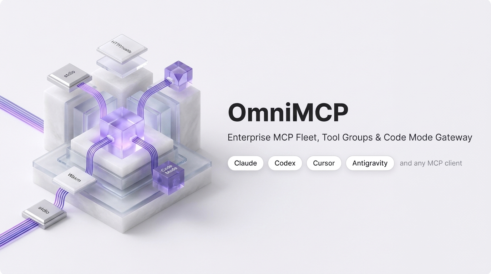

<div align="center">



<p>
  <a href="https://github.com/Rangow4562/omni-mcp-gateway/stargazers"></a>
  <a href="https://github.com/Rangow4562/omni-mcp-gateway/actions/workflows/rust.yml"></a>
  <a href="https://www.npmjs.com/package/@rangow2260/omni-mcp"></a>
  <a href="LICENSE"></a>
  
  <a href="https://modelcontextprotocol.io"></a>
</p>

<p>
  <a href="#quick-start">Quick start</a> ·
  <a href="#why">Why</a> ·
  <a href="#installation-across-all-operating-systems">All OS binaries</a> ·
  <a href="#whats-new-in-v60">What's new in v6.0</a> ·
  <a href="#architecture--endpoints">Architecture</a> ·
  <a href="#safety--governance">Safety</a>
</p>

<a href="https://github.com/Rangow4562/omni-mcp-gateway"></a>

</div>

**OmniMCP** (`omni-mcp` `v6.0`) is a high-performance **Rust** Model Context Protocol (MCP) Gateway, External MCP Fleet Manager, and in-process **Code Mode** runtime. It unifies external stdio/HTTP MCP servers, Virtual Tool Groups, OpenAPI/Protobuf/Thrift services, and an interactive Fleet & Studio UI behind one governed gateway.

- **Unified External MCP Fleet.** Register and supervise external stdio (`omni-process-guard`) and HTTP/HTTPS (`rustls`) MCP servers with live SSE telemetry, health checks, and scoped Virtual Tool Groups.
- **Native Code Mode (`codemode`).** Compiles tool schemas into compact `declare namespace codemode` TypeScript `.d.ts` definitions ($65\%\text{–}95\%$ token reduction) and executes multi-step scripts in an isolated in-process sandbox or `wasmi` Wasm runtime with resumable approval gates.

> [!TIP]
> **One gateway for every MCP client.** Instead of configuring dozens of raw MCP servers inside every IDE and flooding the model's context window with thousands of flat JSON schemas, point Claude, Codex, Cursor, Windsurf, or Antigravity at **OmniMCP** once. OmniMCP handles discovery (Okapi BM25), schema pre-injection, RBAC/OIDC auth, approval gates, and durable SQLite WAL audit trails.

---

## Why

Raw multi-server MCP setups break down as tool counts grow:

| ❌ Connecting 20+ raw MCP servers directly | ✅ Routing through OmniMCP (`v6.0`) |
| :--- | :--- |
| Loads thousands of JSON schemas into every prompt, burning context tokens | Compiles schemas into compact `.d.ts` definitions and pre-injects top-$K$ via Okapi BM25 (`k₁=1.2, b=0.75`) |
| Forces slow multi-turn tool ping-pong for filtering, joins, and loops | Executes procedural `codemode` scripts with SSA auto-parallelization and vectorized columnar pushdown |
| No pause/resume boundary for destructive tool calls | Suspends at `is_mutation: true` (`-32031 APPROVAL_REQUIRED`) with HMAC-SHA256 signed WAL continuations & CAS single-use approval |
| Orphaned stdio child processes and uncontained resource usage | OS-level process containment (`crates/omni-process-guard`: Windows Job Objects, Linux `PR_SET_PDEATHSIG` + `killpg`) |
| No unified auth, rate limiting, or compliance trail | `rustls` TLS/mTLS, OIDC/JWKS (`RS256`/`ES256`/`EdDSA`), RBAC (`Agent`/`Operator`/`Approver`/`Admin`), and SHA-256 Merkle audit log |

---

## Quick start

### 1. Universal Zero-Install via NPX (Windows, macOS, Linux)

No Rust toolchain required — `npx` automatically selects and verifies the native prebuilt binary for your OS and CPU architecture:

```bash
# Start as stdio MCP server for agent harnesses (Claude, Cursor, Codex, Antigravity)
npx -y @rangow2260/omni-mcp --stdio

# Launch the HTTP/SSE Gateway & Fleet UI on port 8080
npx -y @rangow2260/omni-mcp 8080

# Inspect registered services and tools
npx -y @rangow2260/omni-mcp mcp list
npx -y @rangow2260/omni-mcp mcp search driver
```

### 2. Connect your MCP Client

Add to `claude_desktop_config.json`, `.cursor/mcp.json`, or `~/.gemini/config/mcp_config.json`:

```json
{
  "mcpServers": {
    "omni-mcp": {
      "command": "npx",
      "args": ["-y", "@rangow2260/omni-mcp", "--stdio"]
    }
  }
}
```

Or connect via Streamable HTTP (`http://127.0.0.1:8080/omni/mcp` or `http://127.0.0.1:8080/<service>/mcp`).

### 3. Docker (Production)

```bash
docker build -t omni-mcp:v6.0.0 .
docker run --rm -e OMNI_AUTH_SECRET="your-secret" -p 8080:8080 omni-mcp:v6.0.0
```

> [!NOTE]
> Binding to non-loopback addresses (`0.0.0.0`) requires `OMNI_AUTH_SECRET` (or OIDC/JWKS configuration) so unauthenticated management/data-plane exposure is blocked by default.

---

## Installation Across All Operating Systems

Pre-built native binaries (with `SHA256SUMS` verification and Cargo SBOMs) are published for every major OS and architecture on the [v6.0.0 GitHub Release](https://github.com/Rangow4562/omni-mcp-gateway/releases/tag/v6.0.0):

| Operating System | Architecture | Target Triple | Release Binary Asset |
| :--- | :--- | :--- | :--- |
| **macOS** | Apple Silicon (M1–M4) | `aarch64-apple-darwin` | `omni-gateway-darwin-arm64` |
| **macOS** | Intel (`x86_64`) | `x86_64-apple-darwin` | `omni-gateway-darwin-x64` |
| **Linux** | `x86_64` (glibc / musl) | `x86_64-unknown-linux-gnu` | `omni-gateway-linux-x64` |
| **Linux** | ARM64 / AArch64 (glibc / musl) | `aarch64-unknown-linux-gnu` | `omni-gateway-linux-arm64` |
| **Windows** | x64 (Intel / AMD) | `x86_64-pc-windows-msvc` | `omni-gateway-win32-x64.exe` |
| **Windows** | ARM64 (Snapdragon / Surface) | `aarch64-pc-windows-msvc` | `omni-gateway-win32-arm64.exe` |

<details>
<summary>Direct download commands (macOS, Linux, Windows, Build from Source)</summary>

#### macOS (Apple Silicon & Intel)
```bash
# Apple Silicon (ARM64)
curl -fL https://github.com/Rangow4562/omni-mcp-gateway/releases/download/v6.0.0/omni-gateway-darwin-arm64 -o omni-gateway
chmod +x omni-gateway && ./omni-gateway --stdio

# Intel (x64)
curl -fL https://github.com/Rangow4562/omni-mcp-gateway/releases/download/v6.0.0/omni-gateway-darwin-x64 -o omni-gateway
chmod +x omni-gateway && ./omni-gateway --stdio
```

#### Linux (`x86_64` & ARM64)
```bash
# Linux x64
curl -fL https://github.com/Rangow4562/omni-mcp-gateway/releases/download/v6.0.0/omni-gateway-linux-x64 -o omni-gateway
chmod +x omni-gateway && ./omni-gateway --stdio

# Linux ARM64
curl -fL https://github.com/Rangow4562/omni-mcp-gateway/releases/download/v6.0.0/omni-gateway-linux-arm64 -o omni-gateway
chmod +x omni-gateway && ./omni-gateway --stdio
```

#### Windows (PowerShell — x64 & ARM64)
```powershell
# Windows x64
Invoke-WebRequest -Uri "https://github.com/Rangow4562/omni-mcp-gateway/releases/download/v6.0.0/omni-gateway-win32-x64.exe" -OutFile "omni-gateway.exe"
.\omni-gateway.exe --stdio

# Windows ARM64
Invoke-WebRequest -Uri "https://github.com/Rangow4562/omni-mcp-gateway/releases/download/v6.0.0/omni-gateway-win32-arm64.exe" -OutFile "omni-gateway.exe"
.\omni-gateway.exe --stdio
```

#### Build from Source (Any OS with Rust 1.75+)
```bash
cargo build --release --locked --features "os-csprng,tls-rustls,async-runtime,storage-sqlite,sandbox-wasm,process-containment"
./target/release/omni-gateway --stdio
```

</details>

---

## What's New in v6.0

- **Async Runtime & Native `rustls` TLS/mTLS (`async-runtime`, `tls-rustls`)**: `tokio` multi-threaded async listener (`serve_async_listener` / `run_async_server`) with native `rustls` TLS 1.2/1.3 & mutual TLS client-certificate verification.
- **OIDC / JWKS Authentication (`RS256`, `ES256`, `EdDSA`)**: Full asymmetric JWT verification alongside HS256, RFC 8707 resource indicators, RFC 8693 token exchange, and RFC 9728 protected resource metadata.
- **Unified External MCP Fleet & Virtual Tool Groups**: Manage external stdio & HTTP MCP upstreams, organize tools into scoped Virtual Tool Groups, and monitor live SSE telemetry in the React/Vite Fleet & Studio UI (`ToolGroupsStudio`, `CodeModeStudio`).
- **SQLite WAL + CAS + `AuditSink` (`storage-sqlite`)**: Durable SQLite Write-Ahead Log persistence, atomic compare-and-swap continuation consumption, and segmented SHA-256 Merkle audit trail.
- **Wasm Sandbox (`sandbox-wasm`) & Process Containment (`omni-process-guard`)**: `wasmi` fuel-metered WebAssembly execution alongside the sub-millisecond AST Code Mode VM, plus OS-level child-process cleanup (`crates/omni-process-guard`).
- **Modular Code Mode & OpenTelemetry (`src/data_plane/codemode/`, `src/telemetry/`)**: Cleanly decomposed parser, VM, SSA auto-parallelizer, columnar predicate pushdown, TypeScript `.d.ts` generator, Wasm sandbox, and OTLP span exporter.

---

## Architecture & Endpoints

- **Gateway UI & Fleet Dashboard**: `http://127.0.0.1:8080/`
- **Centralized MCP Streamable HTTP**: `POST http://127.0.0.1:8080/omni/mcp`
- **Virtual Service Endpoints**: `POST http://127.0.0.1:8080/<service>/mcp`
- **Control Plane REST & OpenAPI 3.1**: `/api/v1/*`, `/openapi.json`
- **Health, Metrics & SSE**: `/healthz`, `/metrics`, `/api/v1/events`
- **OAuth Protected Resource Metadata (RFC 9728)**: `/.well-known/oauth-protected-resource`

---

## Safety & Governance

- **Zero-Outbound Sandbox Isolation**: `globalOutbound: null` blocks arbitrary network/filesystem access; every call routes through governed `codemode.*` bindings with fuel (`-32032`), memory (`-32036`), and timeout (`-32037`) limits.
- **Schema Preflight & Separation of Duties**: Static AST schema validation (`-32035 SCHEMA_PREFLIGHT_FAILED`) runs before approval gates; approvers cannot approve their own mutation requests.
- **Authoritative `-320xx` Error Contract**: Structured JSON-RPC errors covering `-32020 HEADER_MISMATCH`, `-32021 MISSING_REQUIRED_CLIENT_CAPABILITY`, `-32030 CIRCUIT_OPEN`, `-32031 APPROVAL_REQUIRED`, `-32032 FUEL_EXHAUSTED`, `-32033 OUTBOUND_BLOCKED`, `-32034 SAGA_COMPENSATED`, `-32035 SCHEMA_PREFLIGHT_FAILED`, `-32036 MEMORY_EXHAUSTED`, `-32037 TIMEOUT`, and `-32038 APPROVAL_INVALID`.
- **PII & Secret Redaction**: Deterministic DFA scanner redacts credentials, emails, SSNs, and tokens across logs and telemetry.

---

## License

Licensed under the Apache License, Version 2.0 ([LICENSE](LICENSE)).
