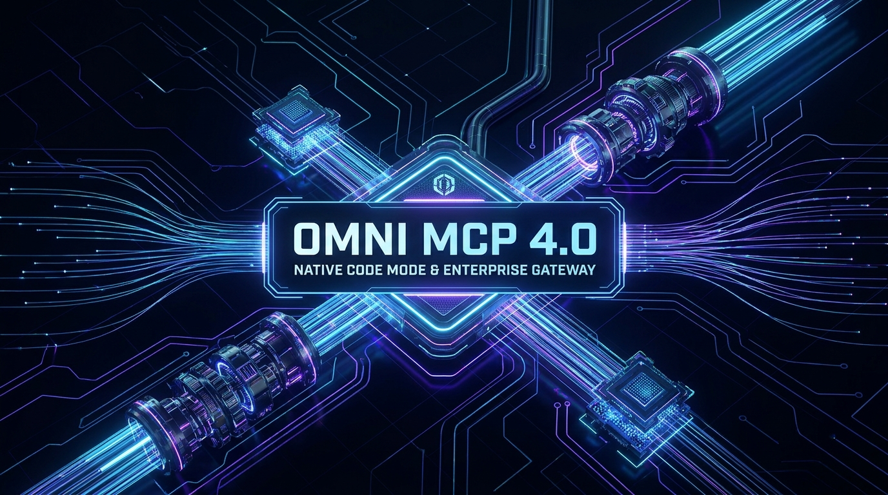

# Omni MCP (`omni-mcp` v2.0 — Native Rust Engine)

[](https://m8ven.ai/mcp/rangow4562-omni-mcp-gateway-twjros?s=readme)

A high-performance, zero-dependency **Rust** enterprise Model Context Protocol (MCP) management platform and runtime gateway reconstructing and advancing the architecture documented (*"Designing MCP Gateway: Uber's MCP Management Platform"*, October 1, 2026).

Omni MCP unifies hundreds of microservices and thousands of tools behind a standardized, sub-millisecond, token-optimized Rust gateway with built-in governance, binary wire protocol translation, incremental discovery, circuit breaking, semantic response caching, and ABAC security.

<p align="center">
  
</p>

---

## Why Rust 2.0? Key Advances Over v1.0

- **Zero-Copy Copy-on-Write (`Arc`) Routing Table**: Data plane readers acquire `Arc<ServerRecord>` handles in nanoseconds without deep-cloning server/tool schemas or blocking concurrent workers.
- **16-Shard Lock-Free-Contention Rate Limiter**: Token-bucket rate limiter sharded across 16 independent locks (`token:actor`), eliminating mutex contention under multi-agent load.
- **Per-Service Circuit Breaker (`Closed` / `Open` / `HalfOpen`)**: Automatically trips when a downstream microservice experiences consecutive failures and fast-fails (`-32030 CIRCUIT_OPEN`) until the recovery window elapses.
- **TTL Semantic Response Cache**: Caches idempotent tool invocations (`service::tool::args`) with automatic cache invalidation whenever a tool's status or version changes in the Control Plane.
- **JSON-RPC 2.0 Batch Execution & `batch_invoke_tools`**: Supports both array batch JSON-RPC 2.0 payloads and multi-tool batch execution via `/omni/mcp`.
- **Durable WAL + Atomic Snapshot Storage Engine**: Crash-safe Write-Ahead Log (`.db-wal`) with 64-bit FNV-1a checksum verification and atomic snapshot compaction (`WalRegistryStore`).
- **DFA PII Scanner**: High-speed deterministic state-machine redaction for emails, phone numbers, SSNs, credit cards, and bearer tokens.
- **Bounded Thread-Pool HTTP/1.1 Keep-Alive Server**: Persistent TCP connections with `TCP_NODELAY` and microsecond latency histograms (`p50`, `p95`, `p99`) exported to `/metrics`.

---

## REA Claim Audit & Rust 2.0 Capabilities

| Document Claim / Capability | Document Statement | Omni MCP Rust Implementation | Status |
| :--- | :--- | :--- | :--- |
| **800+ Servers / 5000+ Tools** | Gateway scales to enterprise volume without context exhaustion | Copy-on-Write `Arc<BTreeMap>` routing table + WAL storage | **Verified Documented Baseline** |
| **Control vs Data Plane** | Centralized Registry (Control) vs Proxy Gateway (Data) | Decoupled `omni_mcp::control_plane` & `omni_mcp::data_plane` | **Verified Architecture** |
| **AutoCrawler** | Cadence workflow scanning IDL registry and native heartbeats | `AutoCrawler` workflow engine with Protobuf/Thrift AST parsers | **Verified Architecture** |
| **Disabled by Default** | Discovery doesn't imply exposure; tools require review & approval | Strict `ToolStatus::Disabled` state machine; requires explicit enablement | **Verified Principle** |
| **Diffs & Rollback** | Tool edits trigger diffs requiring approval; supports rollback | Versioned `ConfigDiff` engine with approval gates and rollback | **Verified Feature** |
| **Dynamic Routing** | Materializes virtual servers at `/<service-name>/mcp` without redeploy | Dynamic HTTP/1.1 dispatch table refreshed on background cadence | **Verified Data Plane** |
| **Wire Translation** | Translates JSON-RPC to HTTP, gRPC, TChannel wire formats | `ProtocolTranslator` binary framing for HTTP, gRPC, TChannel | **Verified Data Plane** |
| **Muttley Delegation** | Downstream calls routed via Muttley service mesh sidecar | `MuttleyMeshClient` sidecar adapter with `p50`/`p95`/`p99` histograms | **Verified Integration** |
| **Security & ABAC** | Server/tool charter policies for humans, services, agents; PII redaction | `SecurityCharterEngine` + DFA `PIIRedactor` | **Verified Security Model** |
| **Omni MCP** | Proxy enabling incremental discovery via 4 standard tools | `OmniMCPServer` with BM25-style ranking + `batch_invoke_tools` | **Verified Context Feature** |
| **Response Projection** | GraphQL-like nested path array trimming response in runtime | `ResponseProjectionEngine` supporting nested keys, `items[].field`, and `*` | **Verified Token Optimization** |
| **Code Mode (`aifx`)** | CLI for coding agents: `mcp list`, `mcp search`, `mcp call` | Native `omni` and `aifx` Rust binaries + `mcp bench` micro-benchmark | **Verified CLI Interface** |
| **Resilience & Caching** | Enterprise fault tolerance and sub-millisecond tail latency | `CircuitBreakerRegistry` + `SemanticResponseCache` + Batch JSON-RPC | **Advanced Rust 2.0 Upgrade** |
| **Registry & Tool UI** | Web interfaces for reviewing configs, diffs, and testing (Figs 3 & 4) | React 18 + Vite application served statically from `ui/dist` at `/` | **Verified Documented UI** |

---

## Architecture Diagram

<p align="center">
  
</p>

```
                    AI Agents / LLMs / Shell Coding Agents
                        │                         │
                        ▼                         ▼
                 Omni MCP Proxy              omni / aifx CLI
             (BM25 Incremental Search)      (Native Rust Binary)
                        │                         │
                        └──────────┬──────────────┘
                                   │
                                   ▼
             ┌───────────────────────────────────────────────┐
             │     RUST DATA PLANE (Proxy Gateway Runtime)   │
             │   Dynamic Virtual Servers: /<service-name>/mcp│
             ├───────────────────────────────────────────────┤
             │  • CoW Arc<BTreeMap> In-Memory Routing Table  │
             │  • 16-Shard Token-Bucket Rate Limiter         │
             │  • ABAC Charter Policy Engine (Actor Access)  │
             │  • Per-Service Circuit Breaker (Fast-Fail)    │
             │  • TTL Semantic Response Cache (Idempotent)   │
             │  • Response Projection Engine (Field Trimmer) │
             │  • DFA PII / Sensitive Data Redactor          │
             │  • Binary Wire Translators (gRPC / Thrift)    │
             │  • Muttley Mesh Client (p50/p95/p99 Metrics)  │
             └───────────────────────┬───────────────────────┘
                                     │
                 ┌───────────────────┴───────────────────┐
                 ▼                                       ▼
        Downstream Services                     Native MCP Servers
     (HTTP / gRPC / TChannel)                     (via MCPFx)

                                   ▲
                                   │ (Syncs Config)
                                   │
             ┌───────────────────────────────────────────────┐
             │       RUST CONTROL PLANE (MCP Registry)       │
             ├───────────────────────────────────────────────┤
             │  • Durable WAL + Atomic Snapshot Store        │
             │  • Disabled-by-Default Policy Enforcer        │
             │  • Config Diff Review, Approval & Rollback    │
             │  • AutoCrawler Cadence Engine                 │
             │  • IDL Parser (Protobuf & Thrift AST + Maps)  │
             │  • LLM Description Enrichment Generator       │
             │  • MCPFx Heartbeat Listener                   │
             │  • 3P OAuth Token Exchanger (Jira / Google)   │
             └───────────────────────────────────────────────┘
```

---

## Codebase Structure

```
omni-mcp/
├── Cargo.toml                  # Rust crate & binary definitions (omni-gateway, omni, aifx)
├── Dockerfile                  # Multi-stage Node + Rust release container build
├── docker-compose.yml          # Containerized deployment with persistent volume
├── .env.example                # Enterprise environment configuration template
├── src/
│   ├── lib.rs                  # Library root exporting all platform modules
│   ├── main.rs                 # `omni-gateway` binary entrypoint
│   ├── json.rs                 # RFC-8259 JSON AST, parser, serializer & `json!` macro
│   ├── config.rs               # Environment configuration with sensible production defaults
│   ├── logging.rs              # Microsecond-precision structured JSON telemetry
│   ├── server.rs               # Bounded thread-pool HTTP/1.1 keep-alive & JSON-RPC 2.0 server
│   ├── models/
│   │   ├── mod.rs
│   │   ├── entities.rs         # ServerRecord, ToolRecord, ToolStatus, ProtocolType, CharterPolicy, ConfigDiff
│   │   └── rpc.rs              # RPCRequest, RPCBatchOrSingle, RPCResponse, RPCError & error codes
│   ├── storage/
│   │   ├── mod.rs
│   │   └── wal_store.rs        # Durable Write-Ahead Log (WAL) + Atomic Snapshot Store (FNV-1a checksums)
│   ├── control_plane/
│   │   ├── mod.rs
│   │   ├── registry.rs         # Concurrent RwLock versioned store, diff approvals, rollback engine
│   │   ├── crawler.rs          # AutoCrawler Cadence discovery workflow engine
│   │   ├── idl_parser.rs       # Protobuf (proto2/proto3 + maps) and Thrift AST parser -> JSON Schema
│   │   ├── description_gen.rs  # LLM description enrichment generator
│   │   ├── native_monitor.rs   # MCPFx heartbeat monitor and listTools discovery
│   │   └── third_party.rs      # 3P OAuth token exchange adapter (Jira, Google)
│   ├── data_plane/
│   │   ├── mod.rs
│   │   ├── cache.rs            # Copy-on-Write Arc<BTreeMap> config cache with background sync
│   │   ├── rate_limiter.rs     # 16-shard token-bucket rate limiter
│   │   ├── circuit_breaker.rs  # Per-service Circuit Breaker & TTL Semantic Response Cache
│   │   ├── security.rs         # ABAC charter policies & DFA PII redactor
│   │   ├── projection.rs       # Response Projection engine (nested paths, arrays `[]`, wildcards `*`)
│   │   ├── translators.rs      # HTTP, gRPC (Protobuf binary frame), and TChannel (Thrift binary frame)
│   │   ├── muttley.rs          # Muttley service mesh sidecar client with p50/p95/p99 latency tracking
│   │   └── gateway.rs          # Dynamic virtual server router (/<service-name>/mcp), single & batch RPC
│   ├── extension/
│   │   ├── mod.rs
│   │   ├── omni_mcp.rs         # Omni MCP proxy server (discover_server, discover_tools, get_tool_schema, invoke_tool, batch_invoke_tools)
│   │   └── aifx.rs             # Code Mode CLI & built-in data-plane micro-benchmark
│   └── bin/
│       ├── omni.rs             # `omni` CLI binary
│       └── aifx.rs             # `aifx` CLI binary
├── ui/                         # React 18 + Vite dashboard (Figures 3 & 4)
│   └── dist/                   # Production built assets served by `omni-gateway`
└── tests/
    └── integration_tests.rs    # Comprehensive integration & unit test suite
```

---

## Quick Start & Usage

### 1. Build Release Binaries

```bash
cargo build --release
```

### 2. Run the Gateway Server

```bash
# Starts the multi-threaded Rust HTTP/1.1 keep-alive server on port 8080
./target/release/omni-gateway 8080
```

Available Endpoints:
- **Interactive UI Dashboard**: `http://localhost:8080/`
- **Liveness Probe**: `http://localhost:8080/healthz`
- **Readiness Probe**: `http://localhost:8080/readyz`
- **Prometheus Metrics**: `http://localhost:8080/metrics`
- **Omni MCP Proxy**: `http://localhost:8080/omni/mcp`
- **Virtual Endpoints**: `http://localhost:8080/<service-name>/mcp`
- **REST Catalog API**: `http://localhost:8080/api/servers`, `http://localhost:8080/api/stats`, `http://localhost:8080/api/diffs`

---

### 3. Code Mode CLI (`omni` / `aifx`)

```bash
# List all registered servers
./target/release/aifx mcp list

# Search for tools across all servers
./target/release/aifx mcp search driver

# Invoke tool through gateway with Response Projection
./target/release/aifx mcp call driverdispatchservice GetDriverLocation \
  --args '{"driver_id": "drv_102"}' \
  --project "data.driver.name,data.driver.vehicle.license_plate"

# Save tool response directly to file for zero-context shell grep
./target/release/aifx mcp call driverdispatchservice GetDriverLocation \
  --args '{"driver_id": "drv_102"}' \
  --output ./driver_info.json

# Run built-in Rust Data Plane Benchmark
./target/release/aifx mcp bench --iterations 50000
```

---

### 4. Running the Tests

```bash
cargo test
```
