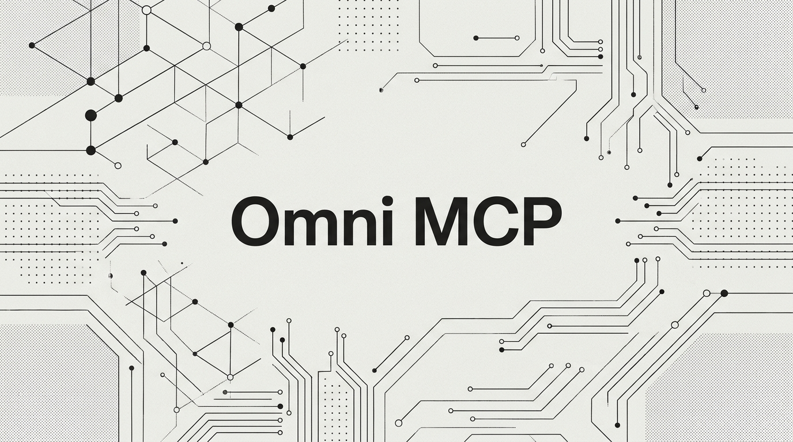
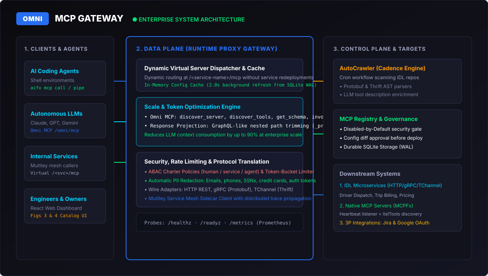
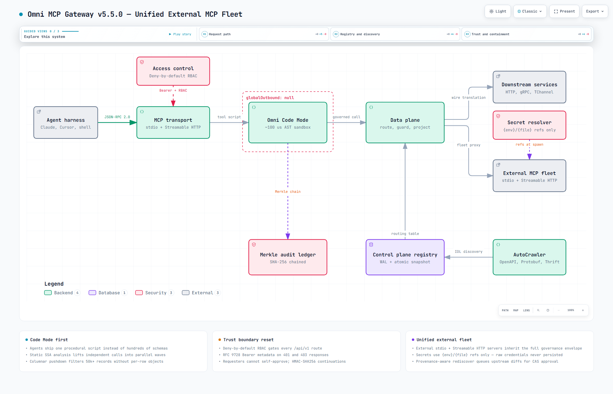

<p align="center">
  
</p>

# Omni MCP (`omni-mcp` v5.5 — Autonomous Runtime & Enterprise MCP Gateway)

[](https://www.npmjs.com/package/@rangow2260/omni-mcp)
[](https://www.npmjs.com/package/@rangow2260/omni-mcp)
[](https://opensource.org/licenses/Apache-2.0)
[](https://github.com/Rangow4562/omni-mcp-gateway/actions)
[](https://m8ven.ai/mcp/rangow4562-omni-mcp-gateway-twjros?s=readme)

A high-performance, zero-dependency **Rust** enterprise Model Context Protocol (MCP) management platform and runtime gateway combining native in-process **Omni Code Mode** with enterprise service mesh governance, Okapi BM25 intent ranking, columnar predicate pushdown, resumable continuation snapshots, and declarative Saga compensations.

Omni MCP unifies hundreds of microservices and thousands of tools behind a standardized, sub-millisecond, token-optimized Rust gateway with:
- **Native Code Mode Execution (`codemode`)**: In-process sandbox executing JavaScript/TypeScript syntax scripts with closure syntax (`|x| expr`) and service host calls in $\sim 0.10\text{ ms}$ ($100\ \mu\text{s}$).
- **Resumable AST Continuations**: Stateless suspend/resume of execution state (`SuspendedExecutionFrame`) across approval gates (`is_mutation: true`) via durable FNV-1a checksummed WAL snapshots.
- **Zero-Copy Columnar Predicate Pushdown**: Compiles `.filter()` and `.map()` AST closures directly into vectorized `PhysicalExpr` pipelines over contiguous columnar batches (`ColumnarRecordBatch`).
- **Static AST SSA Auto-Parallelization**: Automatic dependency analysis lifts independent sequential `await codemode.*` calls into concurrent `Stmt::ParallelWave` batches without requiring complex LLM `Promise.all` emissions.
- **Declarative Saga Compensation Rollbacks**: Ephemeral execution transaction logs unwind completed mutations in reverse (`LIFO`) order when a downstream step fails.
- **Speculative 0-Turn Schema Pre-Injection**: True Okapi BM25 ($k_1 = 1.2, b = 0.75$) + stem routing injects the top-$K$ highest-confidence `.d.ts` declarations on Turn 1 based on natural-language user prompts.
- **Deterministic Simulation Testing (`dst`) Engine**: 64-bit `Xoshiro256StarStar` seeded PRNG fault-injection suite validating agent scripts against network drops, circuit trips, latency spikes, and malformed payloads.
- **Authoritative `-320xx` Error Contract & Multi-Revision MCP Protocol Negotiation**: Compiler-checked `FeatureStatus` enum mapping every runtime guardrail (`-32030`..`-32038`) and negotiating official MCP revisions (`2024-11-05`, `2025-03-26`, `2025-06-18`, `2025-11-25`), with graceful fallback for future spec revisions like `2026-07-28` and stateless `server/discover` over Streamable HTTP.
- **Live HTTP/1.1 Downstream Transport (`transport-http`)**: Feature-gated, pure standard library connection-pooled HTTP client with timeouts, keep-alive, and jittered exponential retries feeding per-service circuit breakers and Saga rollbacks.
- **Schema Preflight Validator (`-32035 SCHEMA_PREFLIGHT_FAILED`)**: Static AST input schema type-checker detecting all violations in a single pass before execution or approval gates for single-turn LLM self-correction.
- **HMAC-SHA256 Authenticated Continuations & Approval Hardening**: Tamper-proof continuation frames signed via HMAC-SHA256 with atomic compare-and-swap (CAS) single-use binding (`-32038 APPROVAL_INVALID`), approver identity and argument digest verification, and crash-safe WAL/snapshot Saga compensation ledger.
- **Comprehensive Sandbox Resource Limits**: Strict execution guardrails bounding instruction fuel (`-32032`), string/array heap growth (`-32036 MEMORY_EXHAUSTED`), wall-clock time (`-32037 TIMEOUT`), and internal panic containment (`catch_unwind`).
- **Dynamic TypeScript Declarations (`declare namespace codemode`)**: Automatically converts OpenAPI 3.1, Protobuf, and Thrift JSON Schemas into compact `.d.ts` declarations, compressing tool prompt token footprints by $65\%$ to $95\%$.
- **Search & Execute Pattern**: Built-in `codemode.search(query)` and `codemode.describe(server, tool?)` allowing agents to discover and inspect typed definitions on demand without context bloat.
- **Zero-Outbound Isolation & Approval Gates**: `globalOutbound: null` isolation blocks raw `fetch()` or filesystem calls, while human-in-the-loop approval gates intercept state-mutating operations (`is_mutation: true`).
- **Full Mesh Governance**: Wire envelope framing & protocol translation (gRPC, HTTP, simulated RPC), circuit breaking, semantic caching, ABAC security, OpenTelemetry W3C distributed tracing, canary weighted routing, and SHA-256 Merkle audit trail.

---

---

## 🛡️ What's New in Version 5.0 ("Trust Boundary Reset & MCP 2026-07-28 Conformance")

- 🤝 **Full MCP `2026-07-28` Protocol Conformance (B1–B10)**:
  - Required `"resultType": "complete"` on all results and `"resultType": "input_required"` with `requestState` for multi-round-trip requests (B1).
  - Deterministic lexicographical ordering and caching metadata (`ttlMs: 300000`, `cacheScope: "workspace"`) across `tools/list`, `resources/list`, `prompts/list`, and `resources/templates/list` (B2).
  - Streamable HTTP protocol header validation on POST `/omni/mcp` and `/<service>/mcp`: requires `Mcp-Method` and `Mcp-Name`, rejecting mismatches with HTTP 400 and `-32020 HEADER_MISMATCH` (B3).
  - Pruned deprecated endpoints (`ping`, `logging/setLevel`, `roots/list_changed`) and validated client capabilities with `-32021 MISSING_REQUIRED_CLIENT_CAPABILITY` (B4).
  - Spec-reserved error code allocation (`-32020..-32099` for spec, `-32000..-32019` for gateway) with backward-compatible `data.legacy_code` mappings (B5).
  - RFC 9728 protected resource metadata at `/.well-known/oauth-protected-resource`, HTTP 401 `WWW-Authenticate: Bearer resource_metadata=...`, and HTTP 403 `insufficient_scope` (B6).
  - MCP Tasks extension (`io.modelcontextprotocol/tasks`) exposing `tasks/get` and `tasks/update` for suspended execution frame lifecycle management (B7).
  - Deprecated legacy `/sse` endpoint returning `410 Gone` by default (opt-in `--features legacy-sse`) (B8).
- 🛡️ **Universal Route Authorization & Atomic Approvals (A1–A6)**:
  - Deny-by-default role-based access control (RBAC) across all `/api/*` and `/api/v1/*` endpoints (`Agent`, `Operator`, `Approver`, `Admin`).
  - Atomic compare-and-swap (CAS) frame consumption under write lock preventing race conditions on multi-approver resumes.
  - Separation of duties cryptographically forbidding mutation requesters from approving their own actions.
  - Length-prefixed HMAC-SHA256 continuation signing over all 12 frame fields with argument digest verification.
- 🌐 **HTTP Front-Door Hardening & DoS Containment (A7–A10, A14)**:
  - Recursive JSON parser depth guard (`MAX_JSON_DEPTH = 64`) preventing stack-overflow crashes.
  - Bounded worker channel shedding saturated load with `503 Service Unavailable`, plus connection-level `catch_unwind` preventing thread death.
  - Persistent `BufReader` framing across HTTP/1.1 keep-alive loops with strict digit-only `Content-Length` checks.
- ⚡ **Architecture, Observability & Tooling (D7, D8, C1)**:
  - $O(1)$ ring-buffer trace eviction via `VecDeque<TraceSpan>`.
  - Versioned `/api/v1/*` REST routes and OpenAPI 3.1 specification at `/openapi.json`.
  - CLI subcommand direct execution (`omni-gateway list`, `omni migrate`).

---

## 🤝 What's New in Version 4.7 ("Protocol Parity & Real Wire")

- 🤝 **MCP Protocol Parity (`2024-11-05`, `2025-03-26`, `2025-06-18`, `2025-11-25`) (M1)**: First-class protocol capability matrix supporting four active revisions with graceful fallback for `2026-07-28`. Implements stateless `server/discover`, `subscriptions/listen`, `_meta` protocol version and client capability negotiation, batch gating, W3C trace context bridging, and Streamable HTTP on `/omni/mcp` and `/<service>/mcp` with deprecated legacy `/sse`.
- 🌐 **Live HTTP/1.1 Downstream Transport (`transport-http`) (M2)**: Feature-gated, pure standard library HTTP/1.1 downstream client with connection pooling, keep-alive, connect/read/write timeouts, and bounded retries with jitter feeding the per-service circuit breaker and Saga unwinder.
- 📋 **Schema Preflight Validator (`-32035 SCHEMA_PREFLIGHT_FAILED`) (M3)**: Static AST input schema type-checker validating parameters against registered schemas before approval gates or execution, collecting all violations in a single pass for single-turn LLM correction.
- 🔐 **Approval & Continuation Hardening + Persistent Saga Ledger (M4)**: Authenticated continuation frames via HMAC-SHA256, atomic compare-and-swap single-use approval binding (`-32038 APPROVAL_INVALID`), OS entropy mixing, and crash-safe WAL/snapshot persistence of in-flight Saga compensations.
- 🧱 **Sandbox Resource Limits (M5)**: Comprehensive sandbox boundaries with memory limit tracking (`-32036 MEMORY_EXHAUSTED`), wall-clock execution timeouts (`-32037 TIMEOUT`), and panic containment (`catch_unwind`).
- 🛡️ **HTTP Surface Hardening & Universal RBAC (H1)**: DNS rebinding protection via Origin validation, loopback bind by default with non-loopback startup guard, universal Bearer authentication and role-based access control (RBAC) across all `/api/*` endpoints, slowloris timeouts, header line and size caps, and HTTP request smuggling protection.

---

## 🛡️ What's New in Version 4.6 ("Honesty & Hardening")

- 🧪 **Code Mode Test Fortress (M1)**: In-module `#[cfg(test)]` unit test suites across `codemode.rs`, `json.rs`, `wal_store.rs`, and `gateway.rs` verifying parser diagnostics, evaluator closures, fuel exhaustion (`-32032`), `globalOutbound: null` isolation (`-32033`), vectorized `PhysicalExpr` evaluation, `SuspendedExecutionFrame` round-trip resume identity, FNV-1a WAL corruption rejection, and Saga LIFO unwinding order.
- 🎯 **True Okapi BM25 Ranking (M2)**: Replaces additive substring scoring with full Okapi BM25 ($\text{IDF}$ corpus weighting, term-frequency saturation $k_1 = 1.2$, document length normalization $b = 0.75$, camelCase/snake_case splitting, suffix stemming, and field boosts) across `speculative_pre_inject`, `discover_server`, and `recommend_tools`.
- 📐 **Authoritative `-320xx` Error-Code Contract (M3)**: Strongly-typed `FeatureStatus` enum and structured `RPCError` contract covering `-32030 CIRCUIT_OPEN`, `-32031 APPROVAL_REQUIRED`, `-32032 FUEL_EXHAUSTED`, `-32033 OUTBOUND_BLOCKED`, `-32034 SAGA_COMPENSATED`, and `-32035 SCHEMA_PREFLIGHT_FAILED`.
- 🤝 **MCP Protocol Version Negotiation (M4)**: Lifecycle negotiation on `initialize` echoing client `protocolVersion` when in `{"2024-11-05", "2025-03-26"}` (defaulting to `"2025-03-26"`), plus additive `2025-03-26` tool capability annotations (`readOnlyHint`, `destructiveHint`, `idempotentHint`, `openWorldHint`).
- 🧹 **Single-Sourced Versioning & Documentation Honesty**: Rust runtime versions single-sourced from `env!("CARGO_PKG_VERSION")` with an automated drift-guard test across `Cargo.toml`, `package.json`, `ui/package.json`, and `README.md`.

---

## 🚀 What's New in Version 4.5

- 🔄 **Resumable AST Continuations for Approval Gates (Stateless Suspend/Resume)**: Serializes instruction pointer, scope heap, and Merkle hashes into Crockford Base32 ULID (`SuspendedExecutionFrame`) in durable WAL when hitting `APPROVAL_REQUIRED`, resuming at `instruction_ptr + 1` upon approval without re-running read tools.
- ⚡ **Zero-Copy Columnar `RecordBatch` & Vectorized `PhysicalExpr` Pushdown**: Compiles `.filter()` and `.map()` AST closures into vectorized columnar physical expressions over typed contiguous arrays, evaluating predicates ($\ge, \le, ==, !=, <, >$) over $50,000+$ records in microseconds without per-row object allocations.
- 🔀 **Static AST Auto-Parallelization (Compiler SSA DAG Pass)**: Automatically analyzes variable read/write sets and lifts consecutive independent `codemode.*` calls into concurrent `Stmt::ParallelWave` execution batches via `std::thread::scope`.
- ↩️ **Declarative Saga Compensation for Multi-Mutation Rollbacks**: Unwinds completed mutations in reverse (`LIFO`) order via `MutationCompensationSpec` whenever a multi-step script fails mid-flight or trips `-32030 CIRCUIT_OPEN`, logging cryptographic rollback events in the Merkle audit trail.
- 🎯 **Speculative 0-Turn Schema Pre-Injection**: BM25 + stem/tag matching pre-populates `{{types}}` with the top-$K$ highest-confidence TypeScript declarations on Turn 1 based on natural-language user prompts.
- 🎲 **Deterministic Simulation Testing (`dst`) Engine**: Pure Rust 64-bit `Xoshiro256StarStar` seeded PRNG chaos harness validating script resilience across $N$ deterministic runs with injected network drops, latency spikes, and circuit breakers.

---

## ⚡ What's New in Version 4.0

- ⚡ **Omni Code Mode Engine**: Native in-process execution engine in pure Rust. LLMs write procedural scripts instead of juggling hundreds of flat tool schemas or suffering through slow multi-turn tool chaining.
- 📜 **Automatic TypeScript Type Generation (`{{types}}`)**: Dynamically compiles registered tool JSON Schemas into compact `declare namespace codemode { ... }` TypeScript definitions. Supports `{{types}}` prompt template injection and `omni://codemode/types.d.ts` resource access.
- 🔬 **Sub-Millisecond Polyglot Sandbox**: AST interpreter booting in $< 50\ \mu\text{s}$ and evaluating multi-step tool pipelines, loops, and closures (`.filter()`, `.map()`, `.reduce()`, `.dedup_by_key()`) with zero external C/C++ dependencies.
- 🖨️ **Captured Console Output**: Intercepts `console.log`, `console.warn`, `console.error`, and `print`, returning structured `CodeOutput { result, logs, pending_approvals, _metrics }` for seamless LLM self-correction.
- 🔒 **Human-in-the-Loop Mutation Approval**: Pauses destructive operations (`is_mutation: true`) when `require_mutation_approval: true` is passed, returning structured `APPROVAL_REQUIRED` (`-32031`) states with argument previews and resumable WAL continuation snapshots.
- 🛡️ **Zero-Outbound Isolation (`globalOutbound: null`)**: Strictly denies unauthorized outbound network or filesystem calls, enforcing $100\%$ mediation through governed `codemode.*` bindings.
- 💻 **Universal Multi-Platform Support**: Pre-built native release binaries for **macOS ARM64 (Apple Silicon)**, **macOS x64 (Intel)**, **Linux ARM64**, **Linux x64**, **Windows x64**, and **Windows ARM64**.

---

## 💻 Installation Across All Operating Systems

### 1. Universal Zero-Install via NPX (Windows, macOS, Linux)

No Rust compiler, toolchain, or local build required — automatically resolves and caches the native binary for your OS and CPU architecture:

```bash
# Start as stdio MCP server for agent harnesses (Claude, Cursor, Windsurf, Antigravity)
npx -y @rangow2260/omni-mcp --stdio

# Alternatively, run from GitHub Packages (@rangow4562 scope)
# npx -y @rangow4562/omni-mcp --stdio

# Launch the multi-threaded HTTP/1.1 Gateway server on port 8080
npx -y @rangow2260/omni-mcp 8080

# Run the Code Mode CLI
npx -y @rangow2260/omni-mcp mcp list
npx -y @rangow2260/omni-mcp mcp search driver

# Speculative 0-turn TypeScript declaration resolution (Okapi BM25)
npx -y @rangow2260/omni-mcp aifx mcp types --intent "Process customer refund and verify payment ledger"

# Resume suspended execution frame after human-in-the-loop approval
npx -y @rangow2260/omni-mcp aifx mcp resume 01JC1234567890ABCDEFGHJKMN --approver "secops-lead"

# Run deterministic simulation testing (DST) with seeded fault injection
npx -y @rangow2260/omni-mcp aifx mcp simulate --code "const res = await codemode.paymentsservice.payments_charge({ customer_id: 'cust_1', amount_cents: 1000 });" --seed 42 --runs 10
```

### 2. Native Pre-Built Binaries by Operating System

| Operating System | Architecture | Target Triple | Release Binary Asset |
| :--- | :--- | :--- | :--- |
| **macOS** | Apple Silicon (M1/M2/M3/M4) | `aarch64-apple-darwin` | `omni-gateway-darwin-arm64` |
| **macOS** | Intel (x86_64) | `x86_64-apple-darwin` | `omni-gateway-darwin-x64` |
| **Linux** | x86_64 (glibc) | `x86_64-unknown-linux-gnu` | `omni-gateway-linux-x64` |
| **Linux** | ARM64 / AArch64 | `aarch64-unknown-linux-gnu` | `omni-gateway-linux-arm64` |
| **Windows** | x64 (Intel / AMD) | `x86_64-pc-windows-msvc` | `omni-gateway-win32-x64.exe` |
| **Windows** | ARM64 (Snapdragon / Surface) | `aarch64-pc-windows-msvc` | `omni-gateway-win32-arm64.exe` |

#### 🍎 macOS (Apple Silicon & Intel)
```bash
# Apple Silicon (ARM64)
curl -fL https://github.com/Rangow4562/omni-mcp-gateway/releases/download/v5.5.1/omni-gateway-darwin-arm64 -o omni-gateway
chmod +x omni-gateway && ./omni-gateway --stdio

# Intel (x64)
curl -fL https://github.com/Rangow4562/omni-mcp-gateway/releases/download/v5.5.1/omni-gateway-darwin-x64 -o omni-gateway
chmod +x omni-gateway && ./omni-gateway --stdio
```

#### 🐧 Linux (x86_64 & ARM64)
```bash
# Linux x64
curl -fL https://github.com/Rangow4562/omni-mcp-gateway/releases/download/v5.5.1/omni-gateway-linux-x64 -o omni-gateway
chmod +x omni-gateway && ./omni-gateway --stdio

# Linux ARM64
curl -fL https://github.com/Rangow4562/omni-mcp-gateway/releases/download/v5.5.1/omni-gateway-linux-arm64 -o omni-gateway
chmod +x omni-gateway && ./omni-gateway --stdio
```

#### 🪟 Windows (PowerShell — x64 & ARM64)
```powershell
# Windows x64
Invoke-WebRequest -Uri "https://github.com/Rangow4562/omni-mcp-gateway/releases/download/v5.5.1/omni-gateway-win32-x64.exe" -OutFile "omni-gateway.exe"
.\omni-gateway.exe --stdio

# Windows ARM64
Invoke-WebRequest -Uri "https://github.com/Rangow4562/omni-mcp-gateway/releases/download/v5.5.1/omni-gateway-win32-arm64.exe" -OutFile "omni-gateway.exe"
.\omni-gateway.exe --stdio
```

#### 🦀 Build from Source (Any OS with Rust `std`)
```bash
cargo build --release
./target/release/omni-gateway --stdio
```

---

## Why Rust? Key Advances Over Legacy Architectures

- **Zero-Copy Copy-on-Write (`Arc`) Routing Table**: Data plane readers acquire `Arc<ServerRecord>` handles in nanoseconds without deep-cloning server/tool schemas or blocking concurrent workers.
- **16-Shard Lock-Free-Contention Rate Limiter**: Token-bucket rate limiter sharded across 16 independent locks (`token:actor`), eliminating mutex contention under multi-agent load.
- **Per-Service Circuit Breaker (`Closed` / `Open` / `HalfOpen`)**: Automatically trips when a downstream microservice experiences consecutive failures and fast-fails (`-32030 CIRCUIT_OPEN`) until the recovery window elapses.
- **TTL Semantic Response Cache**: Caches idempotent tool invocations (`service::tool::args`) with automatic cache invalidation whenever a tool's status or version changes in the Control Plane.
- **JSON-RPC 2.0 Batch Execution & `batch_invoke_tools`**: Supports both array batch JSON-RPC 2.0 payloads and multi-tool batch execution via `/omni/mcp`.
- **Durable WAL + Atomic Snapshot Storage Engine**: Crash-safe Write-Ahead Log (`.db-wal`) with 64-bit FNV-1a checksum verification and atomic snapshot compaction (`WalRegistryStore`).
- **DFA PII & Secrets Scanner**: High-speed deterministic state-machine redaction for emails, phone numbers, SSNs, credit cards, AWS keys, GitHub tokens, and API tokens.
- **Bounded Thread-Pool HTTP/1.1 Keep-Alive Server**: Persistent TCP connections with `TCP_NODELAY` and microsecond latency histograms ($p_{50}$, $p_{95}$, $p_{99}$) exported to `/metrics`.

---

## REA Claim Audit & v3.0–v5.0 Capabilities

| Document Claim / Capability | Document Statement | Omni MCP Rust Implementation | Status | Evidence (Test) |
| :--- | :--- | :--- | :--- | :--- |
| **800+ Servers / 5000+ Tools** | Gateway scales to enterprise volume without context exhaustion | Copy-on-Write `Arc<BTreeMap>` routing table + WAL storage | **Verified Baseline** | `tests/integration_tests.rs::test_scale_benchmark_routing` |
| **Control vs Data Plane** | Centralized Registry (Control) vs Proxy Gateway (Data) | Decoupled `omni_mcp::control_plane` & `omni_mcp::data_plane` | **Verified Architecture** | `tests/integration_tests.rs::test_registry_to_gateway_sync` |
| **AutoCrawler** | Periodic workflow scanning IDL registry and native heartbeats | In-process `AutoCrawler` discovery engine with Protobuf/Thrift/OpenAPI parsers | **Verified Architecture** | `src/control_plane/autocrawler.rs::tests::test_crawler_run` |
| **Universal IDL Support** | Ingest gRPC, Thrift, and REST specifications | Protobuf v2/v3, Thrift AST, OpenAPI 3.1 & Swagger 2.0 parsers | **v3.0 Upgrade** | `src/control_plane/autocrawler.rs::tests::test_parse_openapi` |
| **Disabled by Default** | Discovery doesn't imply exposure; tools require review & approval | Strict `ToolStatus::Disabled` state machine; requires explicit enablement | **Verified Principle** | `src/control_plane/registry.rs::tests::test_tool_status_default` |
| **Diffs & Rollback** | Tool edits trigger diffs requiring approval; supports rollback | Versioned `ConfigDiff` engine with approval gates and rollback | **Verified Feature** | `tests/integration_tests.rs::test_config_diff_and_rollback` |
| **Dynamic Routing** | Materializes virtual servers at `/<service-name>/mcp` without redeploy | Dynamic HTTP/1.1 dispatch table refreshed on background cadence | **Verified Data Plane** | `tests/integration_tests.rs::test_http_gateway_server` |
| **Wire Translation** | Translates JSON-RPC to HTTP, gRPC, and simulated RPC wire formats | `HttpDownstreamClient` pure-`std` live HTTP/1.1 transport (`transport-http`) + in-memory RPC envelope framing | **v4.7 Live HTTP + Simulated RPC** | `tests/integration_tests.rs::test_http_transport_downstream_real_wire` |
| **Mesh Delegation** | Downstream calls routed via service mesh sidecars | `HttpDownstreamClient` for real HTTP endpoints + simulated mesh sidecar adapter | **v4.7 Live HTTP + Mesh Simulator** | `tests/integration_tests.rs::test_downstream_delegation` |
| **Security & ABAC** | Server/tool charter policies for humans, services, agents; PII redaction | `SecurityCharterEngine` + DFA `PIIRedactor` (with API key redaction) | **Verified Security Model** | `src/data_plane/security.rs::tests::test_pii_redaction` |
| **Omni MCP Discovery** | Proxy enabling incremental discovery via standard tools | `OmniMCPServer` with Okapi BM25 ranking + `recommend_tools` + `explain_error` | **v4.6 Upgrade** | `tests/integration_tests.rs::test_bm25_intent_ranking` |
| **MCP Resources & Prompts**| Full resource catalog and diagnostic runbooks | `resources/list`, `resources/read`, `prompts/list`, `prompts/get` | **v3.0 Upgrade** | `tests/integration_tests.rs::test_v5_0_protocol_conformance_2026_07_28` |
| **OpenTelemetry Tracing** | Distributed end-to-end W3C request tracing | `traceparent` context injection, in-memory collector, `/api/traces` | **v3.0 Upgrade** | `tests/integration_tests.rs::test_w3c_trace_context_propagation` |
| **Canary & Resilient Fallback**| Safe progressive rollouts and fault-tolerant fallbacks | Percentage weighted traffic routing + automatic fallback execution | **v3.0 Upgrade** | `src/data_plane/gateway.rs::tests::test_canary_routing` |
| **Cryptographic Audit** | Tamper-evident immutable ledger for enterprise compliance | Zero-dependency FIPS 180-4 SHA-256 Merkle chained audit store | **v3.0 Upgrade** | `src/control_plane/audit_log.rs::tests::test_merkle_chain_integrity` |
| **Streamable HTTP & SSE** | MCP transport over standard HTTP POST/GET and legacy SSE | Streamable HTTP on `/omni/mcp` and `/<service>/mcp` + deprecated legacy `/sse` | **v4.7 Upgrade** | `tests/integration_tests.rs::test_v5_0_protocol_conformance_2026_07_28` |
| **Response Projection** | GraphQL-like nested path array trimming response in runtime | `ResponseProjectionEngine` supporting nested keys, `items[].field`, and `*` | **Verified Token Optimization** | `src/data_plane/response_projection.rs::tests::test_projection` |
| **Code Mode (`aifx`)** | CLI for coding agents: `mcp list`, `mcp search`, `mcp call` | Native `omni` and `aifx` Rust binaries + `mcp bench` micro-benchmark | **Verified CLI Interface** | `tests/integration_tests.rs::test_cli_subcommands` |
| **Resilience & Caching** | Enterprise fault tolerance and sub-millisecond tail latency | `CircuitBreakerRegistry` + `SemanticResponseCache` + Batch JSON-RPC | **Verified Data Plane** | `src/data_plane/gateway.rs::tests::test_circuit_breaker` |
| **Registry & Tool UI** | Web interfaces for reviewing configs, diffs, and testing | React 18 + Vite application served statically from `ui/dist` at `/` | **Verified Documented UI** | `tests/integration_tests.rs::test_ui_static_serving` |
| **In-Process Code Mode** | Sub-millisecond polyglot script execution without multi-turn loops | Pure-Rust AST interpreter ($< 50\ \mu\text{s}$ boot) with captured `CodeOutput` | **v4.0 Upgrade** | `src/extension/codemode.rs::tests::test_interpreter_basic` |
| **Dynamic `.d.ts` Generation** | Compress tool prompt token footprint by $65\%$ to $95\%$ | Auto-compiled `declare namespace codemode` + `omni://codemode/types.d.ts` | **v4.0 Upgrade** | `src/extension/codemode.rs::tests::test_dts_generation` |
| **Zero-Outbound & HITL Gates** | Block raw network/FS access and gate destructive mutations | `globalOutbound: null` isolation + `is_mutation: true` `APPROVAL_REQUIRED` | **v4.0 Upgrade** | `src/extension/codemode.rs::tests::test_outbound_blocked` |
| **Resumable Continuations** | Stateless suspend/resume of paused scripts across cluster nodes | HMAC-SHA256 authenticated `SuspendedExecutionFrame` with atomic CAS (`-32013`) | **v5.0 Hardened** | `tests/integration_tests.rs::test_v5_0_atomic_cas_concurrent_double_resume_and_digest` |
| **Columnar Pushdown** | Vectorized closure filtering without per-row heap allocations | `ColumnarRecordBatch` contiguous arrays + compiled `PhysicalExpr` pipelines | **v4.5 Upgrade** | `src/extension/codemode.rs::tests::test_columnar_pushdown` |
| **SSA Auto-Parallelization** | Automatic parallelization of sequential independent tool calls | Static AST read/write analysis lifting calls into `Stmt::ParallelWave` | **v4.5 Upgrade** | `src/extension/codemode.rs::tests::test_ssa_parallel_wave` |
| **Declarative Saga Rollbacks** | Automatic reverse-order unwinding of partial multi-step mutations | `MutationCompensationSpec` LIFO unwind + crash-safe persistent WAL ledger | **v4.7 Upgrade** | `src/extension/codemode.rs::tests::test_saga_compensation` |
| **Speculative 0-Turn Types** | Eliminate discovery round-trip on initial agent turn | Sub-ms Okapi BM25 ($k_1=1.2, b=0.75$) routing pre-populating Turn 1 `{{types}}` | **v4.6 Upgrade** | `tests/integration_tests.rs::test_speculative_pre_injection` |
| **Deterministic Simulation** | Fault-injection chaos testing for agent scripts prior to rollout | 64-bit `Xoshiro256StarStar` seeded PRNG harness (`aifx mcp simulate`) | **v4.5 Upgrade** | `src/extension/codemode.rs::tests::test_dst_simulation` |
| **Error-Code Contract** | Machine-readable `-320xx` JSON-RPC 2.0 error & status surface | Spec-reserved `-32020..-32099` + implementation `-32000..-32019` | **v5.0 Conformance** | `src/models/rpc.rs::tests::gateway_error_block_is_contiguous_and_unique` |
| **MCP Protocol Parity** | Multi-version MCP lifecycle handshake across active revisions | Full parity for `2024-11-05` through `2026-07-28` (`PROTOCOL_CAPABILITY_TABLE`) | **v5.0 Conformance** | `tests/integration_tests.rs::test_v5_0_protocol_conformance_2026_07_28` |
| **Schema Preflight Validator** | Static AST validation against registered tool inputSchema | Single-pass AST type check (`-32010 SCHEMA_PREFLIGHT_FAILED`) before approval | **v4.7 Upgrade** | `src/models/schema_validator.rs::tests::test_preflight_validation` |
| **Sandbox Resource Limits** | Comprehensive memory, time, and panic safety boundaries | Memory caps (`-32011`), wall-clock timeouts (`-32012`), and panic containment | **v4.7 Upgrade** | `src/extension/codemode.rs::tests::test_sandbox_limits` |

---

## Authoritative JSON-RPC 2.0 Error-Code Contract (`-320xx` Table)

All gateway, discovery, and Code Mode error states map to compiler-checked constants in `src/models/rpc.rs` and `FeatureStatus`:

| Code | Constant | `FeatureStatus` | Meaning & Remediation |
| :--- | :--- | :--- | :--- |
| `-32700` | `PARSE_ERROR` | `ERROR` | Invalid JSON payload received by the gateway. |
| `-32600` | `INVALID_REQUEST` | `ERROR` | Malformed JSON-RPC 2.0 request envelope or empty batch. |
| `-32601` | `METHOD_NOT_FOUND` | `ERROR` | Unknown RPC method, virtual server, or tool identifier. |
| `-32602` | `INVALID_PARAMS` | `ERROR` | Missing or invalid method/tool parameters. |
| `-32603` | `INTERNAL_ERROR` | `ERROR` | Unhandled runtime or syntax error inside script evaluation. |
| `-32001` | `UNAUTHORIZED` | `ERROR` | Caller actor (`human`, `service`, `agent`) rejected by ABAC `CharterPolicy`. |
| `-32002` | `TOOL_DISABLED` | `ERROR` | Target server or tool is `DISABLED` or `PENDING_REVIEW` in the Control Plane. |
| `-32003` | `DOWNSTREAM_ERROR` | `ERROR` | Downstream service or protocol translator returned an execution failure. |
| `-32004` | `RATE_LIMITED` | `ERROR` | Sharded token-bucket rate limit (`rate_limit_rpm`) exceeded for caller actor (legacy alias: `-32029`). |
| `-32005` | `CIRCUIT_OPEN` | `CIRCUIT_OPEN` | Per-service circuit breaker is tripped open; fast-failing until cooldown expires (legacy alias: `-32030`). |
| `-32006` | `APPROVAL_REQUIRED` | `APPROVAL_REQUIRED` | Mutating tool (`is_mutation: true`) paused at human-in-the-loop gate; resume via `execution_id` (legacy alias: `-32031`). |
| `-32007` | `FUEL_EXHAUSTED` | `FUEL_EXHAUSTED` | Code Mode script exceeded deterministic instruction fuel limit (`max_operations`) (legacy alias: `-32032`). |
| `-32008` | `OUTBOUND_BLOCKED` | `OUTBOUND_BLOCKED` | Direct network/filesystem access (`fetch`, `fs`) blocked by `globalOutbound: null` sandbox (legacy alias: `-32033`). |
| `-32009` | `SAGA_COMPENSATED` | `SAGA_ROLLED_BACK` | Multi-step script failed after mutations; completed mutations were unwound in LIFO order (legacy alias: `-32034`). |
| `-32010` | `SCHEMA_PREFLIGHT_FAILED` | `SCHEMA_PREFLIGHT_FAILED` | Tool arguments failed AST static input schema preflight validation before approval or execution (legacy alias: `-32035`). |
| `-32011` | `MEMORY_EXHAUSTED` | `MEMORY_EXHAUSTED` | Code Mode script exceeded maximum memory allocation budget (`max_memory_bytes`) (legacy alias: `-32036`). |
| `-32012` | `TIMEOUT` | `TIMEOUT` | Code Mode script exceeded wall-clock execution time limit (`max_execution_time_ms`) (legacy alias: `-32037`). |
| `-32013` | `APPROVAL_INVALID` | `APPROVAL_INVALID` | Continuation token verification failed, expired, replayed, or arguments were tampered (legacy alias: `-32038`). |
| `-32020` | `HEADER_MISMATCH` | `ERROR` | Streamable HTTP `Mcp-Method` / `Mcp-Name` header mismatch (MCP 2026-07-28 Spec-Reserved). |
| `-32021` | `MISSING_REQUIRED_CLIENT_CAPABILITY` | `ERROR` | Client omitted a mandatory capability required by the method (MCP 2026-07-28 Spec-Reserved). |
| `-32022` | `UNSUPPORTED_PROTOCOL_VERSION` | `ERROR` | Requested protocol version is not supported by gateway (MCP 2026-07-28 Spec-Reserved). |

---

## Architecture Diagram

<p align="center">
  
</p>

> **Interactive diagram**: open [`docs/omni-mcp-architecture.html`](docs/omni-mcp-architecture.html) — a self-contained v5.5.0 map of the gateway with guided views for the request path, registry & discovery, and trust & containment.



```
                    AI Agents / LLMs / Shell Coding Agents
                        │                         │
                        ▼                         ▼
                  Omni MCP Proxy              omni / aifx CLI
           (BM25 + 0-Turn {{types}})       (Native Rust Binary)
                        │                         │
                        └──────────┬──────────────┘
                                   │
                                   ▼
             ┌──────────────────────────────────────────────────┐
             │   AUTONOMOUS CODE MODE ENGINE (v4.0 / v4.5)      │
             ├──────────────────────────────────────────────────┤
             │  • Polyglot AST Sandbox (~100 us, Outbound:null) │
             │  • Static SSA Pass (Stmt::ParallelWave Batching) │
             │  • ColumnarRecordBatch & PhysicalExpr Pushdown   │
             │  • Resumable Continuations (SuspendedExecFrame)  │
             │  • Declarative Saga Rollbacks (LIFO Unwinding)   │
             │  • Xoshiro256StarStar Seeded DST Fault Harness   │
             └───────────────────────┬──────────────────────────┘
                                     │
                                     ▼
             ┌──────────────────────────────────────────────────┐
             │     RUST DATA PLANE (Proxy Gateway Runtime)      │
             │   Dynamic Virtual Servers: /<service-name>/mcp   │
             ├──────────────────────────────────────────────────┤
             │  • CoW Arc<BTreeMap> In-Memory Routing Table     │
             │  • 16-Shard Token-Bucket Rate Limiter            │
             │  • OpenTelemetry W3C Trace Injector & Collector  │
             │  • Canary Weighted Traffic Router (0-100%)       │
             │  • Resilient Automatic Fallback Tool Execution   │
             │  • Per-Service Circuit Breaker (Fast-Fail)       │
             │  • TTL Semantic Response Cache (Idempotent)      │
             │  • Response Projection Engine (Field Trimmer)    │
             │  • DFA PII & API Key Redactor                    │
             │  • Wire Translators (HTTP, gRPC, Thrift)         │
             │  • SHA-256 Merkle Cryptographic Audit Logger     │
             └───────────────────────┬──────────────────────────┘
                                     │
                 ┌───────────────────┴───────────────────┐
                 ▼                                       ▼
        Downstream Services                     Native MCP Servers
     (HTTP / gRPC / Mesh RPC)                    (via Heartbeat)

                                   ▲
                                   │ (Syncs Config & WAL Snapshots)
                                   │
             ┌──────────────────────────────────────────────────┐
             │       RUST CONTROL PLANE (MCP Registry)          │
             ├──────────────────────────────────────────────────┤
             │  • Durable WAL + Atomic Snapshot Store           │
             │  • Disabled-by-Default Policy Enforcer           │
             │  • Config Diff Review, Approval & Rollback       │
             │  • MutationCompensationSpec Saga Registry        │
             │  • AutoCrawler Universal IDL Engine              │
             │    - Protobuf v2/v3 AST Parser                   │
             │    - Thrift AST Parser                           │
             │    - OpenAPI 3.1 & Swagger 2.0 Parser            │
             │  • LLM Description Enrichment Generator          │
             │  • Service Mesh Heartbeat Listener               │
             │  • 3P OAuth Token Exchanger (Jira / Google)      │
             └──────────────────────────────────────────────────┘
```

---

## Available Endpoints & APIs

### HTTP / REST Endpoints
- **Interactive UI Dashboard**: `http://localhost:8080/`
- **Liveness Probe**: `http://localhost:8080/healthz`
- **Readiness Probe**: `http://localhost:8080/readyz`
- **Prometheus Metrics**: `http://localhost:8080/metrics`
- **Streamable HTTP MCP Proxy (Primary Transport)**: `http://localhost:8080/omni/mcp` (POST for JSON-RPC 2.0 / GET for capabilities)
- **Direct Virtual Service Endpoints**: `http://localhost:8080/<service-name>/mcp`
- **Server-Sent Events (SSE, deprecated legacy transport)**: `http://localhost:8080/sse` (returns `Deprecation: @deprecated` header)
- **Authenticated REST & Control Plane APIs** (Requires Bearer authorization with role-based access control):
  - **`Agent` role**: `/api/execute`, `/api/stats`, `/api/servers`, `/api/codemode/eval`, `/api/codemode/types`, `/api/codemode/speculative_types`, `/api/codemode/simulate`
  - **`Operator` role**: `/api/traces`, `/api/audit`, `/api/audit/verify`, `/api/diffs`, `/api/tools/propose_update`
  - **`Approver` role**: `/api/codemode/suspended`, `/api/codemode/resume`, `/api/diffs/approve`
  - **`Admin` role**: `/api/tools/toggle_status`, `/api/servers/toggle_status`, `/api/tools/rollback`, `/api/crawler/trigger`


### Omni MCP Tools (11 Core Capabilities)

1. `discover_server`: Semantic keyword/intent discovery of virtual microservices across the enterprise.
2. `discover_tools`: Inspect active, enabled tools for an identified microservice.
3. `get_tool_schema`: Retrieve full JSON schema, parameter constraints, and canary metadata.
4. `invoke_tool`: Invoke discovered tools with optional GraphQL-style field projection (`_projection`).
5. `batch_invoke_tools`: Execute parallel multi-tool call graphs in a single agent turn.
6. `recommend_tools`: Autonomous planning tool analyzing agent goals to recommend an ordered pipeline of tools across microservices.
7. `explain_error`: Self-healing diagnostics tool providing root cause analysis, circuit breaker status, and fallback options.
8. `codemode`: High-performance in-process AST execution sandbox running JavaScript/TypeScript scripts with closure syntax (`|x| expr`), host service calls, loops, and approval gates.
9. `get_codemode_types`: Generates TypeScript definitions (`declare namespace codemode`) or performs 0-turn Okapi BM25 speculative pre-injection based on user intent.
10. `resume_codemode`: Atomically resumes a suspended execution continuation frame (`SuspendedExecutionFrame`) using Crockford Base32 ULID and approver identity verification.
11. `simulate_codemode`: Executes scripts across $N$ seeded trajectories using `Xoshiro256StarStar` fault injection to validate resilience before production.

---

## MCP Server Integration & Agent Harness Setup

Omni MCP plugs directly into Claude Desktop, Cursor, Antigravity, or Python agent harnesses.

### Option 1: NPX Zero-Install (Recommended)

```bash
# Start as stdio MCP server for agent harnesses
npx -y @rangow2260/omni-mcp --stdio

# Run the HTTP Gateway server on port 8080
npx -y @rangow2260/omni-mcp 8080

# Run Code Mode CLI
npx -y @rangow2260/omni-mcp mcp list
```

Client configuration (`claude_desktop_config.json`, `.cursor/mcp.json`, `mcp_config.json`):

```json
{
  "mcpServers": {
    "omni-mcp": {
      "command": "npx",
      "args": ["-y", "@rangow2260/omni-mcp", "--stdio"]
    }
  }
}
```

---

### Option 2: Direct Native Binary (Zero-Dependency)

```json
{
  "mcpServers": {
    "omni-mcp": {
      "command": "/path/to/omni-gateway",
      "args": ["--stdio"],
      "env": {
        "OMNI_DATA_DIR": "/path/to/omni-mcp/target/data"
      }
    }
  }
}
```

---

### Option 3: Remote / Streamable HTTP Transport

Start the gateway daemon on port 8080 (`npx -y @rangow2260/omni-mcp 8080`), then configure clients:

- **Centralized Omni Discovery Proxy**: `http://localhost:8080/omni/mcp`
- **Direct Virtual Service Endpoints**: `http://localhost:8080/<service-name>/mcp`

For clients requiring `mcp-remote` over stdio:
```json
{
  "mcpServers": {
    "omni-mcp-http": {
      "command": "npx",
      "args": ["-y", "mcp-remote", "http://localhost:8080/omni/mcp"]
    }
  }
}
```

---

## Client & Agent Harness Configuration Examples

#### 1. Claude Desktop (`claude_desktop_config.json`)
- **Windows**: `%APPDATA%\Claude\claude_desktop_config.json`
- **macOS**: `~/Library/Application Support/Claude/claude_desktop_config.json`
- **Linux**: `~/.config/Claude/claude_desktop_config.json`

```json
{
  "mcpServers": {
    "omni-mcp": {
      "command": "npx",
      "args": ["-y", "@rangow2260/omni-mcp", "--stdio"]
    }
  }
}
```

#### 2. Cursor / Windsurf (`.cursor/mcp.json`)
```json
{
  "mcpServers": {
    "omni-mcp": {
      "command": "npx",
      "args": ["-y", "@rangow2260/omni-mcp", "--stdio"]
    }
  }
}
```

#### 3. Antigravity IDE (`~/.gemini/config/mcp_config.json` or Plugin)
```json
{
  "mcpServers": {
    "omni-mcp": {
      "command": "npx",
      "args": ["-y", "@rangow2260/omni-mcp", "--stdio"]
    }
  }
}
```

#### 4. Python Agent Harness (`mcp` SDK)
See [`examples/mcp-configs/python_harness_agent.py`](examples/mcp-configs/python_harness_agent.py) for a complete working agent implementation connecting to Omni MCP via `mcp.client.stdio.stdio_client`.

---

## License

Licensed under the Apache License, Version 2.0 (the "License"); you may not use this file except in compliance with the License. You may obtain a copy of the License at:

[http://www.apache.org/licenses/LICENSE-2.0](http://www.apache.org/licenses/LICENSE-2.0)