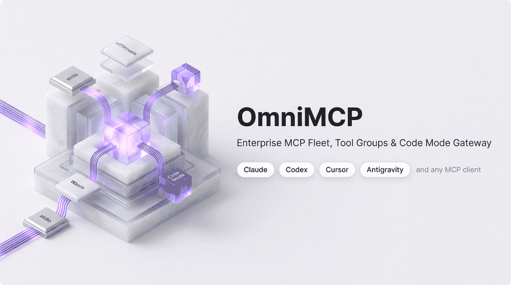
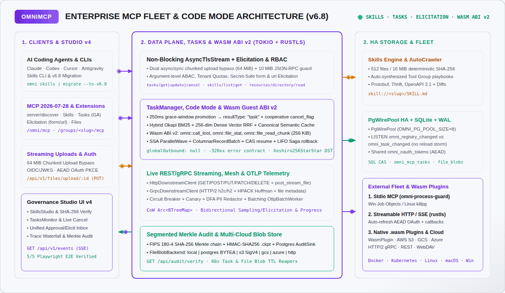

<div align="center">



<p>
  <a href="https://github.com/Rangow4562/omni-mcp-gateway/stargazers"></a>
  <a href="https://github.com/Rangow4562/omni-mcp-gateway/actions/workflows/rust.yml"></a>
  <a href="https://www.npmjs.com/package/@rangow2260/omni-mcp"></a>
  <a href="https://www.npmjs.com/package/@rangow2260/omni-mcp"></a>
  <a href="LICENSE"></a>
  <a href="https://m8ven.ai/mcp/rangow4562-omni-mcp-gateway-twjros?s=readme"></a>
  <a href="https://modelcontextprotocol.io"></a>
</p>

<p>
  <a href="#why-omnimcp">Why</a> ·
  <a href="#installation-across-all-operating-systems">Quick start & OS binaries</a> ·
  <a href="#release-evolution-v40--v68">What's new in v6.8</a> ·
  <a href="#architecture-diagram">Architecture</a> ·
  <a href="#authoritative-json-rpc-20-error-code-contract--320xx-table">Error contract</a> ·
  <a href="#available-endpoints--apis">Endpoints & tools</a> ·
  <a href="#mcp-server-integration--agent-harness-setup">Client setup</a>
</p>

<a href="https://github.com/Rangow4562/omni-mcp-gateway"></a>

</div>

**OmniMCP** (`omni-mcp` `v6.8` — *Skills over MCP, Postgres HA Tasks, Governance-Driven Elicitation, Streaming File Uploads & Wasm Guest ABI v2*) is a high-performance **Rust** Model Context Protocol (MCP) management platform and runtime gateway. It unifies external stdio/HTTP MCP fleets, Virtual Tool Groups, OpenAPI/Protobuf/Thrift services, and an in-process **Code Mode** sandbox behind one governed, sub-millisecond gateway.

- **Unified External MCP Fleet & Tool Groups.** Supervise external stdio (`crates/omni-process-guard`) and HTTP/HTTPS (`rustls`) MCP servers with live SSE telemetry, health checks, and scoped Virtual Tool Groups in the React/Vite Fleet & Studio UI.
- **Native Code Mode (`codemode`) & Wasm Sandbox.** Compiles tool schemas into compact `declare namespace codemode` TypeScript `.d.ts` definitions ($65\%\text{–}95\%$ token compression) and executes procedural scripts in an in-process AST VM ($\sim 100\ \mu\text{s}$) or `wasmi` WebAssembly sandbox with resumable WAL approval gates.

> [!TIP]
> **One gateway for every MCP client.** Instead of wiring dozens of raw MCP servers into every IDE and flooding the model's context window with thousands of flat JSON schemas, connect Claude, Codex, Cursor, Windsurf, or Antigravity to **OmniMCP** once. OmniMCP handles Okapi BM25 discovery, 0-turn `.d.ts` pre-injection, `rustls`/OIDC auth, human-in-the-loop approvals, and SHA-256 Merkle auditing.

---

## Why OmniMCP

Raw multi-server MCP setups degrade quickly as tool counts grow:

| ❌ Connecting raw MCP servers directly | ✅ Routing through OmniMCP (`v6.8`) |
| :--- | :--- |
| Loads thousands of flat JSON schemas into every prompt, burning context tokens | Compiles schemas into compact `.d.ts` definitions and pre-injects top-$K$ via Okapi BM25 ($k_1 = 1.2, b = 0.75$) |
| Forces slow multi-turn tool ping-pong for filtering, joins, and loops | Executes procedural `codemode` scripts with SSA auto-parallelization (`Stmt::ParallelWave`) and vectorized `PhysicalExpr` columnar pushdown |
| No suspend/resume boundary for state-mutating calls | Suspends at `is_mutation: true` (`-32006` / `-32031 APPROVAL_REQUIRED`) with HMAC-SHA256 signed WAL continuations & atomic CAS single-use approval |
| Partial multi-step mutations leave inconsistent downstream state | Declarative LIFO Saga compensation rollbacks (`MutationCompensationSpec`) backed by crash-safe WAL/snapshot ledger |
| Orphaned stdio child processes and unbounded script execution | OS-level process containment (`omni-process-guard`: Windows Job Objects, Linux `PR_SET_PDEATHSIG` + `killpg`), zero-outbound isolation (`globalOutbound: null`), fuel, memory, and timeout caps |
| No unified auth, rate limiting, or compliance trail | `rustls` TLS/mTLS, OIDC/JWKS (`RS256`/`ES256`/`EdDSA`), RFC 8707/8693/9728, RBAC (`Agent`/`Operator`/`Approver`/`Admin`), 16-shard rate limiting, and SQLite WAL + SHA-256 Merkle audit trail |

---

## Core Capabilities at a Glance

- **Native Code Mode Execution (`codemode`)**: In-process sandbox executing JavaScript/TypeScript syntax scripts with closure syntax (`|x| expr`) and service host calls in $\sim 0.10\text{ ms}$ ($100\ \mu\text{s}$), plus optional fuel-metered `wasmi` WebAssembly execution (`sandbox-wasm`).
- **Resumable AST Continuations**: Stateless suspend/resume of execution state (`SuspendedExecutionFrame`) across approval gates (`is_mutation: true`) via durable FNV-1a checksummed WAL / SQLite snapshots (`storage-sqlite`) and atomic compare-and-swap (CAS) single-use binding.
- **Zero-Copy Columnar Predicate Pushdown**: Compiles `.filter()` and `.map()` AST closures directly into vectorized `PhysicalExpr` pipelines over contiguous columnar batches (`ColumnarRecordBatch`), evaluating $50{,}000+$ records in microseconds.
- **Static AST SSA Auto-Parallelization**: Dependency analysis lifts independent sequential `await codemode.*` calls into concurrent `Stmt::ParallelWave` batches without requiring manual `Promise.all` emissions.
- **Speculative 0-Turn Schema Pre-Injection**: True Okapi BM25 ($k_1 = 1.2, b = 0.75$) + camelCase/snake_case stem routing injects the top-$K$ highest-confidence `.d.ts` declarations on Turn 1.
- **Deterministic Simulation Testing (`dst`) Engine**: 64-bit `Xoshiro256StarStar` seeded PRNG fault-injection suite validating scripts against network drops, circuit trips, latency spikes, and malformed payloads.
- **Multi-Revision MCP Protocol Parity**: Negotiates `2024-11-05`, `2025-03-26`, `2025-06-18`, `2025-11-25`, and `2026-07-28` (`PROTOCOL_CAPABILITY_TABLE`), with stateless `server/discover`, MCP Tasks (`io.modelcontextprotocol/tasks`), and Streamable HTTP on `/omni/mcp` and `/<service>/mcp`.
- **Full Mesh Governance**: Wire envelope framing & protocol translation (HTTP/1.1 `transport-http`, gRPC, Thrift, simulated RPC), per-service circuit breakers, TTL semantic response cache, canary weighted routing, W3C OpenTelemetry tracing (`/api/traces`, OTLP), DFA PII/secret redaction, and SHA-256 Merkle audit log.

---

## Release Evolution (`v4.0` → `v6.8`)

<details open>
<summary><strong>🚀 Version 6.8 — Skills over MCP, Postgres HA Tasks, Governance-Driven Elicitation & Streaming File Uploads</strong></summary>

- **Unified `2026-07-28` Discovery, Group Isolation & `PgWirePool`**: Unified `build_server_capabilities()` and `server/discover` across `/omni/mcp`, `/groups/<slug>/mcp`, and `/<service>/mcp`; bounded `PgWirePool` (`OMNI_PG_POOL_SIZE=8`); channel-dispatched `LISTEN/NOTIFY` (`omni_registry_changed` vs `omni_task_changed`).
- **Skills over MCP (`io.modelcontextprotocol/skills`, SEP-2640)**: Validated `SkillRecord` bundles (512 files / 16 MiB, YAML frontmatter, path-traversal guard, deterministic SHA-256 manifests), auto-synthesized Tool Group playbooks, `skills/list`, `skills/get`, `resources/read` (`skill://`), `resources/directory/read`, REST `/api/v1/skills*`, and `omni skills list|publish|verify`.
- **Postgres HA-Backed MCP Tasks (`io.modelcontextprotocol/tasks`, GA)**: `TaskManager` with grace-window promotion (`resultType: "task"`), cooperative cancellation (`cancel_flag` in AST VM & Wasm -> `CodeModeError::Cancelled` -> LIFO Saga rollback), spec-compliant `tasks/get`, `tasks/update` (`inputResponses` -> `{}` ack), `tasks/cancel` (`{}` ack), 60s TTL reaper, and Prometheus metrics.
- **Governance-Driven Elicitation & Multi-Replica OAuth**: Strict secret-key & primitive-schema validator on `form` elicitations, `url`-mode PKCE via `OMNI_PUBLIC_BASE_URL`, and shared `omni_oauth_flows` / AEAD `omni_oauth_tokens` / `omni_upstream_callbacks` across Postgres/SQLite/WAL.
- **Feature-Gated File Uploads (`io.modelcontextprotocol/files`, SEP-2356) & Wasm ABI v2**: Dual async/sync 64 MiB streaming upload bypass (`Transfer-Encoding: chunked` + `PUT` CORS), universal multi-cloud `FileBlobBackend` (`local`, `postgres`, `s3` SigV4, `gcs`, `azure`, `http`), Wasm ABI v2 (`omni::file_stat`, `omni::file_read_chunk`), `HttpDownstreamClient::post_stream_file()`, Governance Studio UI v4, and `omni migrate --to-v6.8`.

</details>

<details open>
<summary><strong>🚀 Version 6.5 — Distributed Cluster HA, Host-Bridged Wasm Plugins, Live Multi-Protocol Wire, Bidirectional MCP & Governance Studio</strong></summary>

- **Real PostgreSQL Cluster Backend (`storage-postgres`)**: Pure-Rust PostgreSQL v3.0 wire client (`SCRAM-SHA-256`, optional `rustls` SSLRequest, parameterized Extended Queries), SQL CAS (`DELETE ... RETURNING`), `LISTEN/NOTIFY` cluster cache invalidation, and dynamic `OMNI_STORAGE_BACKEND=wal|sqlite|postgres` selection + `omni migrate --to-v6.5`.
- **Host-Bridged Wasm Plugins & Guest ABI v1 (`sandbox-wasm`)**: Shared SHA-256 `wasmi::Module` LRU cache, `omni_alloc` / `omni_run` JSON linear-memory ABI, governed `omni::call_tool` host bridge, and native `.wasm` tool plugins (`ProtocolType::WasmPlugin`).
- **Non-Blocking Async TLS (`AsyncTlsStream`), REST Verbs/Templates & Live gRPC/HTTP2**: Non-blocking `tokio` + `rustls` TLS/mTLS (supporting long-lived HTTPS SSE), `GET`/`POST`/`PUT`/`PATCH`/`DELETE` + OpenAPI `{param}` templates over `http://` & `https://`, and live HTTP/2 gRPC & Connect-RPC (`transport-grpc`).
- **Bidirectional Server-Initiated MCP**: Intercepts upstream `sampling/createMessage`, `elicitation/create`, and `roots/list` under `Deny` / `RelayToClient` / `ApprovalGate`, bridges `notifications/progress` to SSE, and propagates `notifications/cancelled`.
- **Hybrid BM25 + Vector RRF Discovery & Canonical Cache**: Zero-external-API 256-dim dense vector + Okapi BM25 RRF ranking (plus optional `OMNI_EMBEDDING_URL`) and recursively key-canonicalized `SemanticResponseCache`.
- **AEAD Token Vault (`ring`), Argument ABAC & Governance Studio v3**: `ChaCha20-Poly1305` OAuth token store with auto-refresh & PKCE routes, JSON-pointer `ArgumentPolicyRule` guardrails, hourly `TenantQuotaTracker` budgets, modular `src/server/*`, live `OtlpBatchWorker`, and UI **Approval Inbox**, **Observability Studio**, and **`mcp.json` Import Wizard**.

</details>

<details>
<summary><strong>⚡ Version 6.0 — Enterprise MCP Fleet, Async Tokio/Rustls, OIDC/JWKS, SQLite WAL & Wasm Sandbox</strong></summary>

- **Async Runtime & Native `rustls` TLS/mTLS (`async-runtime`, `tls-rustls`)**: `tokio` multi-threaded async listener (`serve_async_listener` / `run_async_server`) with native `rustls` TLS 1.2/1.3 & mutual TLS client-certificate verification.
- **OIDC / JWKS Asymmetric Auth (`RS256`, `ES256`, `EdDSA`)**: Full JWKS signature verification alongside HS256 JWTs, RFC 8707 resource indicators, and RFC 8693 token exchange.
- **Unified External MCP Fleet & Virtual Tool Groups**: Manage external stdio & HTTP MCP upstreams, organize tools into scoped Virtual Tool Groups, and inspect live SSE telemetry in the React/Vite Fleet & Studio UI (`ToolGroupsStudio`, `CodeModeStudio`).
- **SQLite WAL + CAS + `AuditSink` (`storage-sqlite`)**: Durable SQLite Write-Ahead Log storage, atomic compare-and-swap continuation consumption, and segmented SHA-256 Merkle audit checkpoints.
- **Wasm Sandbox (`sandbox-wasm`) & Process Containment (`crates/omni-process-guard`)**: `wasmi` fuel-metered WebAssembly sandbox plus OS-level child-process cleanup (Windows Job Objects, Linux `PR_SET_PDEATHSIG` + `killpg`).
- **Modular Code Mode & OpenTelemetry (`src/data_plane/codemode/`, `src/telemetry/`)**: Cleanly decomposed parser, VM, SSA parallelizer, columnar engine, `.d.ts` generator, Wasm sandbox, and OTLP exporter.

</details>

<details>
<summary><strong>🛡️ Version 5.0 — Trust Boundary Reset & MCP 2026-07-28 Conformance</strong></summary>

- **Full MCP `2026-07-28` Protocol Conformance (B1–B10)**: `"resultType": "complete"` / `"input_required"` with `requestState`; deterministic ordering & caching metadata (`ttlMs: 300000`, `cacheScope: "workspace"`); Streamable HTTP `Mcp-Method` / `Mcp-Name` validation (`-32020 HEADER_MISMATCH`); client capability validation (`-32021 MISSING_REQUIRED_CLIENT_CAPABILITY`); spec-reserved `-32020..-32099` error allocation; RFC 9728 `/.well-known/oauth-protected-resource`; MCP Tasks (`tasks/get`, `tasks/update`); deprecated `/sse` returning `410 Gone` unless `--features legacy-sse`.
- **Universal Route Authorization & Atomic Approvals (A1–A6)**: Deny-by-default RBAC (`Agent`, `Operator`, `Approver`, `Admin`), atomic CAS frame consumption, separation of duties, and length-prefixed HMAC-SHA256 continuation signing over all 12 frame fields.
- **HTTP Front-Door Hardening (A7–A10, A14)**: `MAX_JSON_DEPTH = 64` parser guard, bounded worker load shedding (`503`), connection-level `catch_unwind`, persistent `BufReader` framing, $O(1)$ `VecDeque<TraceSpan>` ring buffer, `/api/v1/*` routes, and `/openapi.json`.

</details>

<details>
<summary><strong>🤝 Versions 4.0 – 4.7 — Code Mode Engine, Columnar Pushdown, SSA, Saga & Protocol Parity</strong></summary>

- **v4.7**: Multi-revision MCP parity (`2024-11-05`..`2026-07-28`), live pure-`std` HTTP/1.1 downstream client (`transport-http`), Schema Preflight Validator (`-32035`), persistent Saga ledger, sandbox memory/timeout caps, and Origin/DNS-rebinding protection.
- **v4.6**: Code Mode Test Fortress, True Okapi BM25 ($k_1=1.2, b=0.75$), strongly-typed `FeatureStatus` / `-320xx` contract, `2025-03-26` tool capability annotations, and single-sourced versioning with automated drift-guard test.
- **v4.5**: Resumable AST continuations (Crockford Base32 ULID), zero-copy `ColumnarRecordBatch` + `PhysicalExpr` pushdown, static SSA `Stmt::ParallelWave` auto-parallelization, declarative LIFO Saga rollbacks, 0-turn speculative `{{types}}`, and `Xoshiro256StarStar` DST chaos harness.
- **v4.0**: Pure-Rust AST Code Mode VM ($< 50\ \mu\text{s}$ boot), automatic `declare namespace codemode` `.d.ts` compilation, captured `CodeOutput`, HITL approval gates, `globalOutbound: null` isolation, and 6-target native release binaries.

</details>

---

## Installation Across All Operating Systems

### 1. Universal Zero-Install via NPX (Windows, macOS, Linux)

No Rust compiler, toolchain, or local build required — automatically resolves and verifies the native binary for your OS and CPU architecture:

```bash
# Start as stdio MCP server for agent harnesses (Claude, Cursor, Windsurf, Antigravity)
npx -y @rangow2260/omni-mcp --stdio

# Alternatively, run from GitHub Packages (@rangow4562 scope)
# npx -y @rangow4562/omni-mcp --stdio

# Launch the HTTP/SSE Gateway & Fleet UI on port 8080
npx -y @rangow2260/omni-mcp 8080

# Run the Code Mode CLI
npx -y @rangow2260/omni-mcp mcp list
npx -y @rangow2260/omni-mcp mcp search driver

# Speculative 0-turn TypeScript declaration resolution (Okapi BM25)
npx -y @rangow2260/omni-mcp aifx mcp types --intent "Process customer refund and verify payment ledger"

# Resume suspended execution frame after human-in-the-loop approval
npx -y @rangow2260/omni-mcp aifx mcp resume 01JC1234567890ABCDEFGHJKMN --approver "secops-lead"

# Run deterministic simulation testing (DST) with seeded fault injection
npx -y @rangow2260/omni-mcp aifx mcp simulate --code "const res = await codemode.paymentsservice.payments_charge({ customer_id: 'cust_1', amount_cents: 1000 });" --seed 42 --runs 10
```

### 2. Native Pre-Built Binaries by Operating System

All binaries (plus `omni-*`, `aifx-*`, `omni-mcp-skills-and-plugins-v6.8.5.{tar.gz,zip}`, Cargo SBOMs, and `SHA256SUMS`) are published on the [v6.8.5 GitHub Release](https://github.com/Rangow4562/omni-mcp-gateway/releases/tag/v6.8.5):

| Operating System | Architecture | Target Triple | Release Binary Asset |
| :--- | :--- | :--- | :--- |
| **macOS** | Apple Silicon (M1/M2/M3/M4) | `aarch64-apple-darwin` | `omni-gateway-darwin-arm64` |
| **macOS** | Intel (`x86_64`) | `x86_64-apple-darwin` | `omni-gateway-darwin-x64` |
| **Linux** | `x86_64` (glibc / musl) | `x86_64-unknown-linux-gnu` | `omni-gateway-linux-x64` |
| **Linux** | ARM64 / AArch64 (glibc / musl) | `aarch64-unknown-linux-gnu` | `omni-gateway-linux-arm64` |
| **Windows** | x64 (Intel / AMD) | `x86_64-pc-windows-msvc` | `omni-gateway-win32-x64.exe` |
| **Windows** | ARM64 (Snapdragon / Surface) | `aarch64-pc-windows-msvc` | `omni-gateway-win32-arm64.exe` |

#### 🍎 macOS (Apple Silicon & Intel)
```bash
# Apple Silicon (ARM64)
curl -fL https://github.com/Rangow4562/omni-mcp-gateway/releases/download/v6.8.5/omni-gateway-darwin-arm64 -o omni-gateway
chmod +x omni-gateway && ./omni-gateway --stdio

# Intel (x64)
curl -fL https://github.com/Rangow4562/omni-mcp-gateway/releases/download/v6.8.5/omni-gateway-darwin-x64 -o omni-gateway
chmod +x omni-gateway && ./omni-gateway --stdio
```

#### 🐧 Linux (`x86_64` & ARM64)
```bash
# Linux x64
curl -fL https://github.com/Rangow4562/omni-mcp-gateway/releases/download/v6.8.5/omni-gateway-linux-x64 -o omni-gateway
chmod +x omni-gateway && ./omni-gateway --stdio

# Linux ARM64
curl -fL https://github.com/Rangow4562/omni-mcp-gateway/releases/download/v6.8.5/omni-gateway-linux-arm64 -o omni-gateway
chmod +x omni-gateway && ./omni-gateway --stdio
```

#### 🪟 Windows (PowerShell — x64 & ARM64)
```powershell
# Windows x64
Invoke-WebRequest -Uri "https://github.com/Rangow4562/omni-mcp-gateway/releases/download/v6.8.5/omni-gateway-win32-x64.exe" -OutFile "omni-gateway.exe"
.\omni-gateway.exe --stdio

# Windows ARM64
Invoke-WebRequest -Uri "https://github.com/Rangow4562/omni-mcp-gateway/releases/download/v6.8.5/omni-gateway-win32-arm64.exe" -OutFile "omni-gateway.exe"
.\omni-gateway.exe --stdio
```

#### 🐳 Docker & Build from Source
```bash
# Docker (production container with UI & full v6.8.5 feature set)
docker build -t omni-mcp:v6.8.5 .
docker run --rm -e OMNI_AUTH_SECRET="your-secret" -p 8080:8080 omni-mcp:v6.8.5

# Build from source (Any OS with Rust 1.75+)
cargo build --release --locked --features "os-csprng,tls-rustls,async-runtime,storage-sqlite,storage-postgres,sandbox-wasm,process-containment,transport-http,transport-grpc"
./target/release/omni-gateway --stdio
```

### 3. Universal CLI/Coding-Agent Skills & Enterprise Plugin (`v6.8.5`)

Install the 4 bundled skills (`omni-mcp`, `omni-codemode`, `omni-cli`, `omni-enterprise`) into **Claude Code, Antigravity, Gemini CLI, Codex, Cursor, VS Code / GitHub Copilot, Windsurf, Cline, OpenCode**, or any agent supporting `.agents/skills`:

```bash
# Offline install into project or user scope (zero gateway/database side effects)
omni skills install --agent all --scope project

# Optionally seed the 4 built-in skills into a live MCP skills/list registry
omni skills bootstrap

# Generate a governed Enterprise Plugin (remote HTTPS Streamable HTTP + Tool Group + OIDC/Bearer)
omni plugin init --mode enterprise --agent all \
  --gateway-url https://mcp.corp.example.com \
  --group billing \
  --auth-env OMNI_AUTH_TOKEN \
  --out ./dist/omni-enterprise-plugin

# Export an air-gapped MDM bundle and cryptographically verify SHA-256 integrity
omni plugin export --enterprise --gateway-url https://mcp.corp.example.com --out ./dist/mdm-bundle
omni plugin verify ./dist/mdm-bundle
```

> [!NOTE]
> Binding to non-loopback addresses (`0.0.0.0`) requires `OMNI_AUTH_SECRET`, `OMNI_JWT_SECRET`, or `OMNI_OIDC_JWKS_URI`, and defaults `OMNI_REQUIRE_MCP_AUTH=true` so unauthenticated MCP access is blocked with HTTP `401` + RFC 9728 `WWW-Authenticate`.

---

## Why Rust? Key Advances Over Legacy Architectures

- **Zero-Copy Copy-on-Write (`Arc`) Routing Table**: Data plane readers acquire `Arc<ServerRecord>` handles in nanoseconds without deep-cloning server/tool schemas or blocking concurrent workers.
- **16-Shard Lock-Free-Contention Rate Limiter**: Token-bucket rate limiter sharded across 16 independent locks (`token:actor`), eliminating mutex contention under multi-agent load.
- **Per-Service Circuit Breaker (`Closed` / `Open` / `HalfOpen`)**: Automatically trips when a downstream microservice experiences consecutive failures and fast-fails (`-32030 CIRCUIT_OPEN`) until the recovery window elapses.
- **TTL Semantic Response Cache**: Caches idempotent tool invocations (`service::tool::args`) with automatic cache invalidation whenever a tool's status or version changes in the Control Plane.
- **JSON-RPC 2.0 Batch Execution & `batch_invoke_tools`**: Supports both array batch JSON-RPC 2.0 payloads and multi-tool batch execution via `/omni/mcp`.
- **Durable WAL + SQLite Storage Engine**: Crash-safe Write-Ahead Log (`.db-wal`) with 64-bit FNV-1a checksum verification, atomic snapshot compaction (`WalRegistryStore`), and SQLite WAL + CAS (`storage-sqlite`).
- **DFA PII & Secrets Scanner**: High-speed deterministic state-machine redaction for emails, phone numbers, SSNs, credit cards, AWS keys, GitHub tokens, and API tokens.
- **Async Tokio + Native `rustls` Server**: High-concurrency `tokio` TCP/TLS/mTLS listener (`serve_async_listener` / `run_async_server`) with `TCP_NODELAY` and microsecond latency histograms ($p_{50}$, $p_{95}$, $p_{99}$) exported to `/metrics`.

---

## REA Claim Audit & Verified Capabilities

| Document Claim / Capability | Document Statement | Omni MCP Rust Implementation | Status | Evidence (Test) |
| :--- | :--- | :--- | :--- | :--- |
| **800+ Servers / 5000+ Tools** | Gateway scales to enterprise volume without context exhaustion | Copy-on-Write `Arc<BTreeMap>` routing table + WAL storage | **Verified Baseline** | `tests/integration_tests.rs::test_scale_benchmark_routing` |
| **Control vs Data Plane** | Centralized Registry (Control) vs Proxy Gateway (Data) | Decoupled `omni_mcp::control_plane` & `omni_mcp::data_plane` | **Verified Architecture** | `tests/integration_tests.rs::test_registry_to_gateway_sync` |
| **AutoCrawler** | Periodic workflow scanning IDL registry and native heartbeats | In-process `AutoCrawler` discovery engine with Protobuf/Thrift/OpenAPI parsers | **Verified Architecture** | `src/control_plane/autocrawler.rs::tests::test_crawler_run` |
| **Universal IDL Support** | Ingest gRPC, Thrift, and REST specifications | Protobuf v2/v3, Thrift AST, OpenAPI 3.1 & Swagger 2.0 parsers | **v3.0 Upgrade** | `src/control_plane/autocrawler.rs::tests::test_parse_openapi` |
| **Disabled by Default** | Discovery doesn't imply exposure; tools require review & approval | Strict `ToolStatus::Disabled` state machine; requires explicit enablement | **Verified Principle** | `src/control_plane/registry.rs::tests::test_tool_status_default` |
| **Diffs & Rollback** | Tool edits trigger diffs requiring approval; supports rollback | Versioned `ConfigDiff` engine with approval gates and rollback | **Verified Feature** | `tests/integration_tests.rs::test_config_diff_and_rollback` |
| **Dynamic Routing** | Materializes virtual servers at `/<service-name>/mcp` without redeploy | Dynamic HTTP/1.1 dispatch table refreshed on background cadence | **Verified Data Plane** | `tests/integration_tests.rs::test_http_gateway_server` |
| **Wire Translation** | Translates JSON-RPC to HTTP, gRPC, and simulated RPC wire formats | `HttpDownstreamClient` pure-`std` live HTTP/1.1 transport (`transport-http`) + in-memory RPC envelope framing | **v4.7 Live HTTP + Simulated RPC** | `tests/integration_tests.rs::test_http_transport_downstream_real_wire` |
| **Mesh Delegation** | Downstream calls routed via service mesh sidecars | `HttpDownstreamClient` for real HTTP endpoints + simulated mesh sidecar adapter | **v4.7 Live HTTP + Mesh Simulator** | `tests/integration_tests.rs::test_downstream_delegation` |
| **Security & ABAC** | Server/tool charter policies for humans, services, agents; PII redaction | `SecurityCharterEngine` + DFA `PIIRedactor` (with API key redaction) | **Verified Security Model** | `src/data_plane/security.rs::tests::test_pii_redaction` |
| **Omni MCP Discovery** | Proxy enabling incremental discovery via standard tools | `OmniMCPServer` with Okapi BM25 ranking + `recommend_tools` + `explain_error` | **v4.6 Upgrade** | `tests/integration_tests.rs::test_bm25_intent_ranking` |
| **MCP Resources & Prompts** | Full resource catalog and diagnostic runbooks | `resources/list`, `resources/read`, `prompts/list`, `prompts/get` | **v3.0 Upgrade** | `tests/integration_tests.rs::test_v5_0_protocol_conformance_2026_07_28` |
| **OpenTelemetry Tracing** | Distributed end-to-end W3C request tracing | `traceparent` context injection, `src/telemetry/otlp.rs` collector, `/api/traces` | **v6.0 Modular OTLP** | `tests/integration_tests.rs::test_w3c_trace_context_propagation` |
| **Canary & Resilient Fallback** | Safe progressive rollouts and fault-tolerant fallbacks | Percentage weighted traffic routing + automatic fallback execution | **v3.0 Upgrade** | `src/data_plane/gateway.rs::tests::test_canary_routing` |
| **Cryptographic Audit** | Tamper-evident immutable ledger for enterprise compliance | Zero-dependency FIPS 180-4 SHA-256 Merkle chained audit store + SQLite `AuditSink` | **v6.0 Upgrade** | `src/storage/audit_log.rs::tests::test_merkle_chain_integrity` |
| **Streamable HTTP & SSE** | MCP transport over standard HTTP POST/GET and SSE telemetry | Streamable HTTP on `/omni/mcp` & `/<service>/mcp`, `/api/v1/events` SSE, opt-in legacy `/sse` | **v6.0 Upgrade** | `tests/integration_tests.rs::test_v5_0_protocol_conformance_2026_07_28` |
| **Response Projection** | GraphQL-like nested path array trimming response in runtime | `ResponseProjectionEngine` supporting nested keys, `items[].field`, and `*` | **Verified Token Optimization** | `src/data_plane/response_projection.rs::tests::test_projection` |
| **Code Mode (`aifx`)** | CLI for coding agents: `mcp list`, `mcp search`, `mcp call` | Native `omni` and `aifx` Rust binaries + `mcp bench` micro-benchmark | **Verified CLI Interface** | `tests/integration_tests.rs::test_cli_subcommands` |
| **Resilience & Caching** | Enterprise fault tolerance and sub-millisecond tail latency | `CircuitBreakerRegistry` + `SemanticResponseCache` + Batch JSON-RPC | **Verified Data Plane** | `src/data_plane/gateway.rs::tests::test_circuit_breaker` |
| **Registry & Fleet UI** | Web interfaces for reviewing configs, diffs, tool groups, and Code Mode | React 18 + Vite application served from `ui/dist` at `/` + Playwright E2E | **v6.0 Fleet & Studio UI** | `ui/tests/e2e/fleet.spec.ts` |
| **In-Process Code Mode & Wasm** | Sub-millisecond polyglot script execution without multi-turn loops | Pure-Rust AST VM ($< 50\ \mu\text{s}$ boot) + `wasmi` Wasm sandbox (`sandbox-wasm`) | **v6.0 Modular** | `src/data_plane/codemode/tests.rs` |
| **Dynamic `.d.ts` Generation** | Compress tool prompt token footprint by $65\%$ to $95\%$ | Auto-compiled `declare namespace codemode` + `omni://codemode/types.d.ts` | **v4.0 Upgrade** | `src/data_plane/codemode/tests.rs` |
| **Zero-Outbound & HITL Gates** | Block raw network/FS access and gate destructive mutations | `globalOutbound: null` isolation + `is_mutation: true` `APPROVAL_REQUIRED` | **v4.0 Upgrade** | `src/data_plane/codemode/tests.rs` |
| **Resumable Continuations** | Stateless suspend/resume of paused scripts across cluster nodes | HMAC-SHA256 authenticated `SuspendedExecutionFrame` with atomic CAS (`-32013`) | **v6.0 SQLite CAS** | `tests/integration_tests.rs::test_v5_0_atomic_cas_concurrent_double_resume_and_digest` |
| **Columnar Pushdown** | Vectorized closure filtering without per-row heap allocations | `ColumnarRecordBatch` contiguous arrays + compiled `PhysicalExpr` pipelines | **v4.5 Upgrade** | `src/data_plane/codemode/tests.rs` |
| **SSA Auto-Parallelization** | Automatic parallelization of sequential independent tool calls | Static AST read/write analysis lifting calls into `Stmt::ParallelWave` | **v4.5 Upgrade** | `src/data_plane/codemode/tests.rs` |
| **Declarative Saga Rollbacks** | Automatic reverse-order unwinding of partial multi-step mutations | `MutationCompensationSpec` LIFO unwind + crash-safe persistent WAL ledger | **v4.7 Upgrade** | `src/data_plane/codemode/tests.rs` |
| **Speculative 0-Turn Types** | Eliminate discovery round-trip on initial agent turn | Sub-ms Okapi BM25 ($k_1=1.2, b=0.75$) routing pre-populating Turn 1 `{{types}}` | **v4.6 Upgrade** | `tests/integration_tests.rs::test_speculative_pre_injection` |
| **Deterministic Simulation** | Fault-injection chaos testing for agent scripts prior to rollout | 64-bit `Xoshiro256StarStar` seeded PRNG harness (`aifx mcp simulate`) | **v4.5 Upgrade** | `src/data_plane/codemode/tests.rs` |
| **Process Containment** | Cleanly terminate stdio child process trees across OSes | `crates/omni-process-guard` (Windows Job Objects, Linux `PR_SET_PDEATHSIG` + `killpg`) | **v6.0 New Crate** | `crates/omni-process-guard/src/lib.rs` |

---

## Authoritative JSON-RPC 2.0 Error-Code Contract (`-320xx` Table)

All gateway, discovery, and Code Mode error states map to compiler-checked constants in `src/models/rpc.rs` and `FeatureStatus`:

| Code | Constant | `FeatureStatus` | Meaning & Remediation |
| :--- | :--- | :--- | :--- |
| `-32700` | `PARSE_ERROR` | `ERROR` | Invalid JSON payload received by the gateway. |
| `-32600` | `INVALID_REQUEST` | `ERROR` | Malformed JSON-RPC 2.0 request envelope or empty batch. |
| `-32601` | `METHOD_NOT_FOUND` | `ERROR` | Unknown RPC method, virtual server, or tool identifier. |
| `-32602` | `INVALID_PARAMS` | `ERROR` | Missing or invalid method/tool parameters. |
| `-32603` | `INTERNAL_ERROR` | `ERROR` | Unhandled runtime or syntax error inside script evaluation. |
| `-32001` | `UNAUTHORIZED` | `ERROR` | Caller actor (`human`, `service`, `agent`) rejected by ABAC `CharterPolicy`. |
| `-32002` | `TOOL_DISABLED` | `ERROR` | Target server or tool is `DISABLED` or `PENDING_REVIEW` in the Control Plane. |
| `-32003` | `DOWNSTREAM_ERROR` | `ERROR` | Downstream service or protocol translator returned an execution failure. |
| `-32004` | `RATE_LIMITED` | `ERROR` | Sharded token-bucket rate limit (`rate_limit_rpm`) exceeded for caller actor (legacy alias: `-32029`). |
| `-32005` | `CIRCUIT_OPEN` | `CIRCUIT_OPEN` | Per-service circuit breaker is tripped open; fast-failing until cooldown expires (legacy alias: `-32030`). |
| `-32006` | `APPROVAL_REQUIRED` | `APPROVAL_REQUIRED` | Mutating tool (`is_mutation: true`) paused at human-in-the-loop gate; resume via `execution_id` (legacy alias: `-32031`). |
| `-32007` | `FUEL_EXHAUSTED` | `FUEL_EXHAUSTED` | Code Mode script exceeded deterministic instruction fuel limit (`max_operations`) (legacy alias: `-32032`). |
| `-32008` | `OUTBOUND_BLOCKED` | `OUTBOUND_BLOCKED` | Direct network/filesystem access (`fetch`, `fs`) blocked by `globalOutbound: null` sandbox (legacy alias: `-32033`). |
| `-32009` | `SAGA_COMPENSATED` | `SAGA_ROLLED_BACK` | Multi-step script failed after mutations; completed mutations were unwound in LIFO order (legacy alias: `-32034`). |
| `-32010` | `SCHEMA_PREFLIGHT_FAILED` | `SCHEMA_PREFLIGHT_FAILED` | Tool arguments failed AST static input schema preflight validation before approval or execution (legacy alias: `-32035`). |
| `-32011` | `MEMORY_EXHAUSTED` | `MEMORY_EXHAUSTED` | Code Mode script exceeded maximum memory allocation budget (`max_memory_bytes`) (legacy alias: `-32036`). |
| `-32012` | `TIMEOUT` | `TIMEOUT` | Code Mode script exceeded wall-clock execution time limit (`max_execution_time_ms`) (legacy alias: `-32037`). |
| `-32013` | `APPROVAL_INVALID` | `APPROVAL_INVALID` | Continuation token verification failed, expired, replayed, or arguments were tampered (legacy alias: `-32038`). |
| `-32020` | `HEADER_MISMATCH` | `ERROR` | Streamable HTTP `Mcp-Method` / `Mcp-Name` header mismatch (MCP 2026-07-28 Spec-Reserved). |
| `-32021` | `MISSING_REQUIRED_CLIENT_CAPABILITY` | `ERROR` | Client omitted a mandatory capability required by the method (MCP 2026-07-28 Spec-Reserved). |
| `-32022` | `UNSUPPORTED_PROTOCOL_VERSION` | `ERROR` | Requested protocol version is not supported by gateway (MCP 2026-07-28 Spec-Reserved). |

---

## Architecture Diagram

<p align="center">
  <a href="https://htmlpreview.github.io/?https://github.com/Rangow4562/omni-mcp-gateway/blob/main/docs/omnimcp-architecture.html">
    
  </a>
</p>

> **Interactive diagram**: open [docs/omnimcp-architecture.html](https://github.com/Rangow4562/omni-mcp-gateway/blob/main/docs/omnimcp-architecture.html) (or [view live interactive page](https://htmlpreview.github.io/?https://github.com/Rangow4562/omni-mcp-gateway/blob/main/docs/omnimcp-architecture.html)) — a self-contained interactive map of the gateway with guided views for the request path, registry & discovery, and trust & containment.

```
                    AI Agents / LLMs / Shell Coding Agents
                        │                         │
                        ▼                         ▼
                  Omni MCP Proxy              omni / aifx CLI
           (BM25 + 0-Turn {{types}})       (Native Rust Binary)
                        │                         │
                        └──────────┬──────────────┘
                                   │
                                   ▼
             ┌──────────────────────────────────────────────────┐
             │   AUTONOMOUS CODE MODE ENGINE (v4.0 – v6.8)      │
             ├──────────────────────────────────────────────────┤
             │  • Polyglot AST Sandbox (~100 us, Outbound:null) │
             │  • wasmi Fuel-Metered Wasm Sandbox (sandbox-wasm)│
             │  • Static SSA Pass (Stmt::ParallelWave Batching) │
             │  • ColumnarRecordBatch & PhysicalExpr Pushdown   │
             │  • Resumable Continuations (SuspendedExecFrame)  │
             │  • Declarative Saga Rollbacks (LIFO Unwinding)   │
             │  • Xoshiro256StarStar Seeded DST Fault Harness   │
             └───────────────────────┬──────────────────────────┘
                                     │
                                     ▼
             ┌──────────────────────────────────────────────────┐
             │     RUST DATA PLANE (Async Tokio + rustls)       │
             │   Dynamic Virtual Servers: /<service-name>/mcp   │
             ├──────────────────────────────────────────────────┤
             │  • CoW Arc<BTreeMap> In-Memory Routing Table     │
             │  • OIDC/JWKS (RS256/ES256/EdDSA) & HS256 Auth    │
             │  • 16-Shard Token-Bucket Rate Limiter            │
             │  • OpenTelemetry W3C Trace Injector & OTLP       │
             │  • Canary Weighted Traffic Router (0-100%)       │
             │  • Resilient Automatic Fallback Tool Execution   │
             │  • Per-Service Circuit Breaker (Fast-Fail)       │
             │  • TTL Semantic Response Cache (Idempotent)      │
             │  • Response Projection Engine (Field Trimmer)    │
             │  • DFA PII & API Key Redactor                    │
             │  • Wire Translators (HTTP, gRPC, Thrift)         │
             │  • SHA-256 Merkle Cryptographic Audit Logger     │
             └───────────────────────┬──────────────────────────┘
                                     │
                 ┌───────────────────┴───────────────────┐
                 ▼                                       ▼
        Downstream Services                  External MCP Fleet
     (HTTP / gRPC / Mesh RPC)          (stdio Process Guard / HTTPS)

                                   ▲
                                   │ (Syncs Config & SQLite WAL Snapshots)
                                   │
             ┌──────────────────────────────────────────────────┐
             │       RUST CONTROL PLANE (MCP Registry)          │
             ├──────────────────────────────────────────────────┤
             │  • Durable SQLite WAL + CAS + Atomic Snapshots   │
             │  • Virtual Tool Groups & Disabled-by-Default     │
             │  • Config Diff Review, Approval & Rollback       │
             │  • MutationCompensationSpec Saga Registry        │
             │  • AutoCrawler Universal IDL Engine              │
             │    - Protobuf v2/v3 AST Parser                   │
             │    - Thrift AST Parser                           │
             │    - OpenAPI 3.1 & Swagger 2.0 Parser            │
             │  • LLM Description Enrichment Generator          │
             │  • Service Mesh Heartbeat Listener               │
             │  • 3P OAuth Token Exchanger (Jira / Google)      │
             └──────────────────────────────────────────────────┘
```

---

## Available Endpoints & APIs

### HTTP / REST Endpoints
- **Interactive UI Dashboard & Fleet Studio**: `http://localhost:8080/`
- **Liveness Probe**: `http://localhost:8080/healthz`
- **Readiness Probe**: `http://localhost:8080/readyz`
- **Prometheus Metrics**: `http://localhost:8080/metrics`
- **Streamable HTTP MCP Proxy (Primary Transport)**: `http://localhost:8080/omni/mcp` (POST for JSON-RPC 2.0 / GET for capabilities)
- **Direct Virtual Service Endpoints**: `http://localhost:8080/<service-name>/mcp`
- **Live Telemetry SSE**: `http://localhost:8080/api/v1/events`
- **OpenAPI 3.1 & OAuth Protected Resource Metadata**: `http://localhost:8080/openapi.json`, `/.well-known/oauth-protected-resource`
- **Server-Sent Events (SSE, deprecated legacy transport)**: `http://localhost:8080/sse` (returns `410 Gone` by default; opt-in `--features legacy-sse`)
- **Authenticated REST & Control Plane APIs** (Requires Bearer authorization with role-based access control):
  - **`Agent` role**: `/api/execute`, `/api/stats`, `/api/servers`, `/api/codemode/eval`, `/api/codemode/types`, `/api/codemode/speculative_types`, `/api/codemode/simulate`
  - **`Operator` role**: `/api/traces`, `/api/audit`, `/api/audit/verify`, `/api/diffs`, `/api/tools/propose_update`
  - **`Approver` role**: `/api/codemode/suspended`, `/api/codemode/resume`, `/api/diffs/approve`
  - **`Admin` role**: `/api/tools/toggle_status`, `/api/servers/toggle_status`, `/api/tools/rollback`, `/api/crawler/trigger`

### Omni MCP Tools (11 Core Capabilities)

1. `discover_server`: Semantic keyword/intent discovery of virtual microservices across the enterprise.
2. `discover_tools`: Inspect active, enabled tools for an identified microservice.
3. `get_tool_schema`: Retrieve full JSON schema, parameter constraints, and canary metadata.
4. `invoke_tool`: Invoke discovered tools with optional GraphQL-style field projection (`_projection`).
5. `batch_invoke_tools`: Execute parallel multi-tool call graphs in a single agent turn.
6. `recommend_tools`: Autonomous planning tool analyzing agent goals to recommend an ordered pipeline of tools across microservices.
7. `explain_error`: Self-healing diagnostics tool providing root cause analysis, circuit breaker status, and fallback options.
8. `codemode`: High-performance in-process AST execution sandbox running JavaScript/TypeScript scripts with closure syntax (`|x| expr`), host service calls, loops, and approval gates.
9. `get_codemode_types`: Generates TypeScript definitions (`declare namespace codemode`) or performs 0-turn Okapi BM25 speculative pre-injection based on user intent.
10. `resume_codemode`: Atomically resumes a suspended execution continuation frame (`SuspendedExecutionFrame`) using Crockford Base32 ULID and approver identity verification.
11. `simulate_codemode`: Executes scripts across $N$ seeded trajectories using `Xoshiro256StarStar` fault injection to validate resilience before production.

---

## MCP Server Integration & Agent Harness Setup

OmniMCP plugs directly into Claude Desktop, Codex, Cursor, Windsurf, Antigravity, or Python agent harnesses.

### Option 1: NPX Zero-Install (Recommended)

```bash
# Start as stdio MCP server for agent harnesses
npx -y @rangow2260/omni-mcp --stdio

# Run the HTTP Gateway server on port 8080
npx -y @rangow2260/omni-mcp 8080

# Run Code Mode CLI
npx -y @rangow2260/omni-mcp mcp list
```

Client configuration (`claude_desktop_config.json`, `.cursor/mcp.json`, `mcp_config.json`):

```json
{
  "mcpServers": {
    "omni-mcp": {
      "command": "npx",
      "args": ["-y", "@rangow2260/omni-mcp", "--stdio"]
    }
  }
}
```

### Option 2: Direct Native Binary (Zero-Dependency)

```json
{
  "mcpServers": {
    "omni-mcp": {
      "command": "/path/to/omni-gateway",
      "args": ["--stdio"],
      "env": {
        "OMNI_DATA_DIR": "/path/to/omni-mcp/target/data"
      }
    }
  }
}
```

### Option 3: Remote / Streamable HTTP Transport

Start the gateway daemon on port 8080 (`npx -y @rangow2260/omni-mcp 8080`), then configure clients:

- **Centralized Omni Discovery Proxy**: `http://localhost:8080/omni/mcp`
- **Direct Virtual Service Endpoints**: `http://localhost:8080/<service-name>/mcp`

For clients requiring `mcp-remote` over stdio:
```json
{
  "mcpServers": {
    "omni-mcp-http": {
      "command": "npx",
      "args": ["-y", "mcp-remote", "http://localhost:8080/omni/mcp"]
    }
  }
}
```

---

## Client & Agent Harness Configuration Examples

#### 1. Claude Desktop (`claude_desktop_config.json`)
- **Windows**: `%APPDATA%\Claude\claude_desktop_config.json`
- **macOS**: `~/Library/Application Support/Claude/claude_desktop_config.json`
- **Linux**: `~/.config/Claude/claude_desktop_config.json`

```json
{
  "mcpServers": {
    "omni-mcp": {
      "command": "npx",
      "args": ["-y", "@rangow2260/omni-mcp", "--stdio"]
    }
  }
}
```

#### 2. Cursor / Windsurf (`.cursor/mcp.json`)
```json
{
  "mcpServers": {
    "omni-mcp": {
      "command": "npx",
      "args": ["-y", "@rangow2260/omni-mcp", "--stdio"]
    }
  }
}
```

#### 3. Antigravity IDE (`~/.gemini/config/mcp_config.json` or Plugin)
```json
{
  "mcpServers": {
    "omni-mcp": {
      "command": "npx",
      "args": ["-y", "@rangow2260/omni-mcp", "--stdio"]
    }
  }
}
```

#### 4. Python Agent Harness (`mcp` SDK)
See [`examples/mcp-configs/python_harness_agent.py`](examples/mcp-configs/python_harness_agent.py) for a complete working agent implementation connecting to OmniMCP via `mcp.client.stdio.stdio_client`.

---

## License

Licensed under the Apache License, Version 2.0 ([LICENSE](LICENSE)). See [CHANGELOG.md](CHANGELOG.md) and [docs/RELEASE_v6.8.5.md](docs/RELEASE_v6.8.5.md) for release notes.
