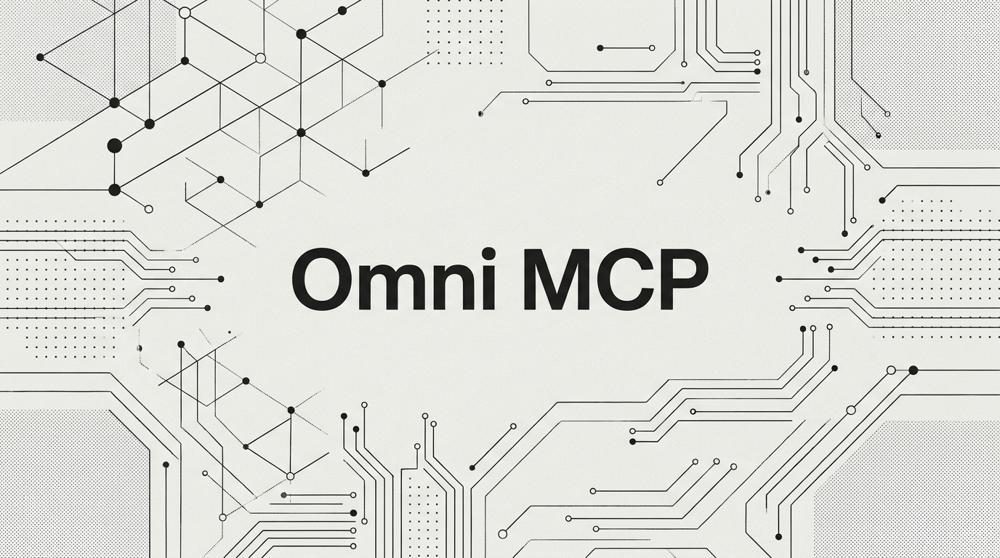
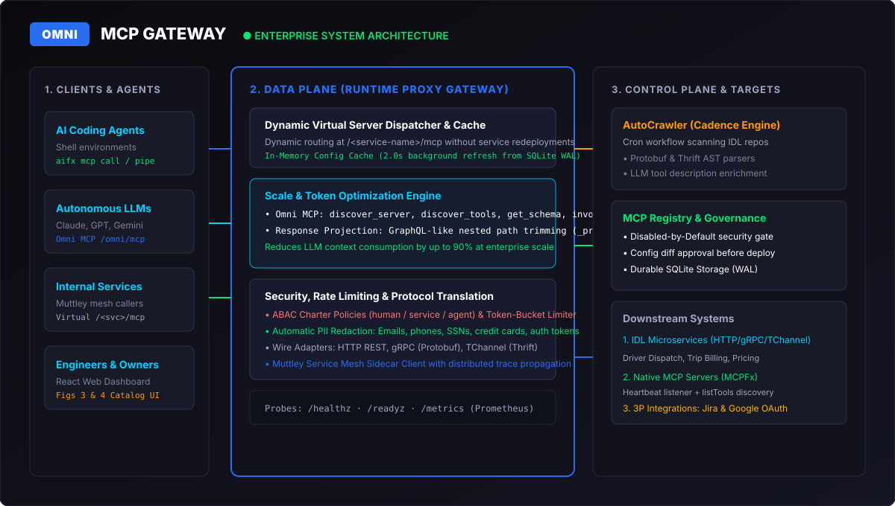

<p align="center">
  
</p>

# Omni MCP (`omni-mcp` v4.5 — Autonomous Runtime & Distributed Mesh Gateway)

[](https://www.npmjs.com/package/@rangow2260/omni-mcp)
[](https://www.npmjs.com/package/@rangow2260/omni-mcp)
[](https://opensource.org/licenses/Apache-2.0)
[](https://github.com/Rangow4562/omni-mcp-gateway/actions)
[](https://m8ven.ai/mcp/rangow4562-omni-mcp-gateway-twjros?s=readme)

A high-performance, zero-dependency **Rust** enterprise Model Context Protocol (MCP) management platform and runtime gateway combining native in-process **Omni Code Mode** with enterprise service mesh governance, columnar SIMD-friendly predicate pushdown, resumable continuation snapshots, and declarative Saga compensations.

Omni MCP unifies hundreds of microservices and thousands of tools behind a standardized, sub-millisecond, token-optimized Rust gateway with:
- **Native Code Mode Execution (`codemode`)**: Polyglot in-process sandbox executing `async () => { ... }` JavaScript/TypeScript and Rust/Rhai scripts in $\sim 0.10\text{ ms}$ ($100\ \mu\text{s}$).
- **Resumable AST Continuations**: Stateless suspend/resume of execution state (`SuspendedExecutionFrame`) across approval gates (`is_mutation: true`) via durable FNV-1a checksummed WAL snapshots.
- **Zero-Copy Columnar Predicate Pushdown**: Compiles `.filter()` and `.map()` AST closures directly into vectorized `PhysicalExpr` pipelines over contiguous columnar batches (`ColumnarRecordBatch`).
- **Static AST SSA Auto-Parallelization**: Automatic dependency analysis lifts independent sequential `await codemode.*` calls into concurrent `Stmt::ParallelWave` batches without requiring complex LLM `Promise.all` emissions.
- **Declarative Saga Compensation Rollbacks**: Ephemeral execution transaction logs unwind completed mutations in reverse (`LIFO`) order when a downstream step fails.
- **Speculative 0-Turn Schema Pre-Injection**: Ultra-fast BM25 + stem routing injects the top-$K$ highest-confidence `.d.ts` declarations on Turn 1 based on natural-language user prompts.
- **Deterministic Simulation Testing (`dst`) Engine**: 64-bit `Xoshiro256StarStar` seeded PRNG fault-injection suite validating agent scripts against network drops, circuit trips, latency spikes, and malformed payloads.
- **Dynamic TypeScript Declarations (`declare namespace codemode`)**: Automatically converts OpenAPI 3.1, Protobuf, and Thrift JSON Schemas into compact `.d.ts` declarations, compressing tool prompt token footprints by $65\%$ to $95\%$.
- **Search & Execute Pattern**: Built-in `codemode.search(query)` and `codemode.describe(server, tool?)` allowing agents to discover and inspect typed definitions on demand without context bloat.
- **Zero-Outbound Isolation & Approval Gates**: `globalOutbound: null` isolation blocks raw `fetch()` or filesystem calls, while human-in-the-loop approval gates intercept state-mutating operations (`is_mutation: true`).
- **Full Mesh Governance**: Binary wire protocol translation (gRPC, HTTP, TChannel), circuit breaking, semantic caching, ABAC security, OpenTelemetry W3C distributed tracing, canary weighted routing, and SHA-256 Merkle audit trail.

---

## 🚀 What's New in Version 4.5

- 🔄 **Resumable AST Continuations for Approval Gates (Stateless Suspend/Resume)**: Serializes instruction pointer, scope heap, and Merkle hashes into Crockford Base32 ULID (`SuspendedExecutionFrame`) in durable WAL when hitting `APPROVAL_REQUIRED`, resuming at `instruction_ptr + 1` upon approval without re-running read tools.
- ⚡ **Zero-Copy Columnar `RecordBatch` & Vectorized `PhysicalExpr` Pushdown**: Compiles `.filter()` and `.map()` AST closures into vectorized columnar physical expressions over typed contiguous arrays, evaluating predicates ($\ge, \le, ==, !=, <, >$) over $50,000+$ records in microseconds without per-row object allocations.
- 🔀 **Static AST Auto-Parallelization (Compiler SSA DAG Pass)**: Automatically analyzes variable read/write sets and lifts consecutive independent `codemode.*` calls into concurrent `Stmt::ParallelWave` execution batches via `std::thread::scope`.
- ↩️ **Declarative Saga Compensation for Multi-Mutation Rollbacks**: Unwinds completed mutations in reverse (`LIFO`) order via `MutationCompensationSpec` whenever a multi-step script fails mid-flight or trips `-32030 CIRCUIT_OPEN`, logging cryptographic rollback events in the Merkle audit trail.
- 🎯 **Speculative 0-Turn Schema Pre-Injection**: BM25 + stem/tag matching pre-populates `{{types}}` with the top-$K$ highest-confidence TypeScript declarations on Turn 1 based on natural-language user prompts.
- 🎲 **Deterministic Simulation Testing (`dst`) Engine**: Pure Rust 64-bit `Xoshiro256StarStar` seeded PRNG chaos harness validating script resilience across $N$ deterministic runs with injected network drops, latency spikes, and circuit breakers.

---

## ⚡ What's New in Version 4.0

- ⚡ **Omni Code Mode Engine**: Native in-process execution engine in pure Rust. LLMs write procedural scripts instead of juggling hundreds of flat tool schemas or suffering through slow multi-turn tool chaining.
- 📜 **Automatic TypeScript Type Generation (`{{types}}`)**: Dynamically compiles registered tool JSON Schemas into compact `declare namespace codemode { ... }` TypeScript definitions. Supports `{{types}}` prompt template injection and `omni://codemode/types.d.ts` resource access.
- 🔬 **Sub-Millisecond Polyglot Sandbox**: AST interpreter booting in $< 50\ \mu\text{s}$ and evaluating multi-step tool pipelines, loops, and closures (`.filter()`, `.map()`, `.reduce()`, `.dedup_by_key()`) with zero external C/C++ dependencies.
- 🖨️ **Captured Console Output**: Intercepts `console.log`, `console.warn`, `console.error`, and `print`, returning structured `CodeOutput { result, logs, pending_approvals, _metrics }` for seamless LLM self-correction.
- 🚧 **Human-in-the-Loop Mutation Approval**: Pauses destructive operations (`is_mutation: true`) when `require_mutation_approval: true` is passed, returning structured `APPROVAL_REQUIRED` states with argument previews.
- 🛡️ **Zero-Outbound Isolation (`globalOutbound: null`)**: Strictly denies unauthorized outbound network or filesystem calls, enforcing $100\%$ mediation through governed `codemode.*` bindings.
- 💻 **Universal Multi-Platform Support**: Pre-built native release binaries for **macOS ARM64 (Apple Silicon)**, **macOS x64 (Intel)**, **Linux ARM64**, **Linux x64**, and **Windows x64**.

---

## ⚡ Instant Quick Start via NPX (Zero-Install)

No Rust compiler, toolchain, or local build required:

```bash
# Start as stdio MCP server for agent harnesses (Claude, Cursor, Antigravity)
npx -y @rangow2260/omni-mcp --stdio

# Launch the multi-threaded HTTP/1.1 Gateway server on port 8080
npx -y @rangow2260/omni-mcp 8080

# Run the Code Mode CLI
npx -y @rangow2260/omni-mcp mcp list
npx -y @rangow2260/omni-mcp mcp search driver

# v4.5: Speculative 0-turn TypeScript declaration resolution
npx -y @rangow2260/omni-mcp aifx mcp types --intent "Process customer refund and verify payment ledger"

# v4.5: Resume suspended execution frame after human-in-the-loop approval
npx -y @rangow2260/omni-mcp aifx mcp resume 01JC1234567890ABCDEFGHJKMN --approver "secops-lead"

# v4.5: Run deterministic simulation testing (DST) with seeded fault injection
npx -y @rangow2260/omni-mcp aifx mcp simulate --code "const res = await codemode.orders.charge({ id: 'ord_1' });" --seed 42 --runs 10
```

---

## Why Rust? Key Advances Over Legacy Architectures

- **Zero-Copy Copy-on-Write (`Arc`) Routing Table**: Data plane readers acquire `Arc<ServerRecord>` handles in nanoseconds without deep-cloning server/tool schemas or blocking concurrent workers.
- **16-Shard Lock-Free-Contention Rate Limiter**: Token-bucket rate limiter sharded across 16 independent locks (`token:actor`), eliminating mutex contention under multi-agent load.
- **Per-Service Circuit Breaker (`Closed` / `Open` / `HalfOpen`)**: Automatically trips when a downstream microservice experiences consecutive failures and fast-fails (`-32030 CIRCUIT_OPEN`) until the recovery window elapses.
- **TTL Semantic Response Cache**: Caches idempotent tool invocations (`service::tool::args`) with automatic cache invalidation whenever a tool's status or version changes in the Control Plane.
- **JSON-RPC 2.0 Batch Execution & `batch_invoke_tools`**: Supports both array batch JSON-RPC 2.0 payloads and multi-tool batch execution via `/omni/mcp`.
- **Durable WAL + Atomic Snapshot Storage Engine**: Crash-safe Write-Ahead Log (`.db-wal`) with 64-bit FNV-1a checksum verification and atomic snapshot compaction (`WalRegistryStore`).
- **DFA PII & Secrets Scanner**: High-speed deterministic state-machine redaction for emails, phone numbers, SSNs, credit cards, AWS keys, GitHub tokens, and API tokens.
- **Bounded Thread-Pool HTTP/1.1 Keep-Alive Server**: Persistent TCP connections with `TCP_NODELAY` and microsecond latency histograms ($p_{50}$, $p_{95}$, $p_{99}$) exported to `/metrics`.

---

## REA Claim Audit & v3.0–v4.5 Capabilities

| Document Claim / Capability | Document Statement | Omni MCP Rust Implementation | Status |
| :--- | :--- | :--- | :--- |
| **800+ Servers / 5000+ Tools** | Gateway scales to enterprise volume without context exhaustion | Copy-on-Write `Arc<BTreeMap>` routing table + WAL storage | **Verified Baseline** |
| **Control vs Data Plane** | Centralized Registry (Control) vs Proxy Gateway (Data) | Decoupled `omni_mcp::control_plane` & `omni_mcp::data_plane` | **Verified Architecture** |
| **AutoCrawler** | Cadence workflow scanning IDL registry and native heartbeats | `AutoCrawler` workflow engine with Protobuf/Thrift/OpenAPI parsers | **Verified Architecture** |
| **Universal IDL Support** | Ingest gRPC, Thrift, and REST specifications | Protobuf v2/v3, Thrift AST, OpenAPI 3.1 & Swagger 2.0 parsers | **v3.0 Upgrade** |
| **Disabled by Default** | Discovery doesn't imply exposure; tools require review & approval | Strict `ToolStatus::Disabled` state machine; requires explicit enablement | **Verified Principle** |
| **Diffs & Rollback** | Tool edits trigger diffs requiring approval; supports rollback | Versioned `ConfigDiff` engine with approval gates and rollback | **Verified Feature** |
| **Dynamic Routing** | Materializes virtual servers at `/<service-name>/mcp` without redeploy | Dynamic HTTP/1.1 dispatch table refreshed on background cadence | **Verified Data Plane** |
| **Wire Translation** | Translates JSON-RPC to HTTP, gRPC, TChannel wire formats | `ProtocolTranslator` binary framing for HTTP, gRPC, TChannel | **Verified Data Plane** |
| **Muttley Delegation** | Downstream calls routed via Muttley service mesh sidecar | `MuttleyMeshClient` sidecar adapter with $p_{50}$/$p_{95}$/$p_{99}$ histograms | **Verified Integration** |
| **Security & ABAC** | Server/tool charter policies for humans, services, agents; PII redaction | `SecurityCharterEngine` + DFA `PIIRedactor` (with API key redaction) | **Verified Security Model** |
| **Omni MCP Discovery** | Proxy enabling incremental discovery via standard tools | `OmniMCPServer` with BM25 ranking + `recommend_tools` + `explain_error` | **v3.0 Upgrade** |
| **MCP Resources & Prompts**| Full resource catalog and diagnostic runbooks | `resources/list`, `resources/read`, `prompts/list`, `prompts/get` | **v3.0 Upgrade** |
| **OpenTelemetry Tracing** | Distributed end-to-end W3C request tracing | `traceparent` context injection, in-memory collector, `/api/traces` | **v3.0 Upgrade** |
| **Canary & Resilient Fallback**| Safe progressive rollouts and fault-tolerant fallbacks | Percentage weighted traffic routing + automatic fallback execution | **v3.0 Upgrade** |
| **Cryptographic Audit** | Tamper-evident immutable ledger for enterprise compliance | Zero-dependency FIPS 180-4 SHA-256 Merkle chained audit store | **v3.0 Upgrade** |
| **Streamable SSE** | Server-Sent Events streaming for tool execution | Native `/sse` endpoint with event dispatch | **v3.0 Upgrade** |
| **Response Projection** | GraphQL-like nested path array trimming response in runtime | `ResponseProjectionEngine` supporting nested keys, `items[].field`, and `*` | **Verified Token Optimization** |
| **Code Mode (`aifx`)** | CLI for coding agents: `mcp list`, `mcp search`, `mcp call` | Native `omni` and `aifx` Rust binaries + `mcp bench` micro-benchmark | **Verified CLI Interface** |
| **Resilience & Caching** | Enterprise fault tolerance and sub-millisecond tail latency | `CircuitBreakerRegistry` + `SemanticResponseCache` + Batch JSON-RPC | **Verified Data Plane** |
| **Registry & Tool UI** | Web interfaces for reviewing configs, diffs, and testing | React 18 + Vite application served statically from `ui/dist` at `/` | **Verified Documented UI** |
| **In-Process Code Mode** | Sub-millisecond polyglot script execution without multi-turn loops | Pure-Rust AST interpreter ($< 50\ \mu\text{s}$ boot) with captured `CodeOutput` | **v4.0 Upgrade** |
| **Dynamic `.d.ts` Generation** | Compress tool prompt token footprint by $65\%$ to $95\%$ | Auto-compiled `declare namespace codemode` + `omni://codemode/types.d.ts` | **v4.0 Upgrade** |
| **Zero-Outbound & HITL Gates** | Block raw network/FS access and gate destructive mutations | `globalOutbound: null` isolation + `is_mutation: true` `APPROVAL_REQUIRED` | **v4.0 Upgrade** |
| **Resumable Continuations** | Stateless suspend/resume of paused scripts across cluster nodes | Crockford Base32 ULID `SuspendedExecutionFrame` in FNV-1a checksummed WAL | **v4.5 Upgrade** |
| **Columnar Pushdown** | Vectorized closure filtering without per-row heap allocations | `ColumnarRecordBatch` contiguous arrays + compiled `PhysicalExpr` pipelines | **v4.5 Upgrade** |
| **SSA Auto-Parallelization** | Automatic parallelization of sequential independent tool calls | Static AST read/write analysis lifting calls into `Stmt::ParallelWave` | **v4.5 Upgrade** |
| **Declarative Saga Rollbacks** | Automatic reverse-order unwinding of partial multi-step mutations | `MutationCompensationSpec` LIFO unwind + Merkle cryptographic receipts | **v4.5 Upgrade** |
| **Speculative 0-Turn Types** | Eliminate discovery round-trip on initial agent turn | Sub-ms BM25 + stem/tag routing pre-populating Turn 1 `{{types}}` | **v4.5 Upgrade** |
| **Deterministic Simulation** | Fault-injection chaos testing for agent scripts prior to rollout | 64-bit `Xoshiro256StarStar` seeded PRNG harness (`aifx mcp simulate`) | **v4.5 Upgrade** |

---

## Architecture Diagram

<p align="center">
  
</p>

```
                    AI Agents / LLMs / Shell Coding Agents
                        │                         │
                        ▼                         ▼
                  Omni MCP Proxy              omni / aifx CLI
           (BM25 + 0-Turn {{types}})       (Native Rust Binary)
                        │                         │
                        └──────────┬──────────────┘
                                   │
                                   ▼
             ┌──────────────────────────────────────────────────┐
             │   AUTONOMOUS CODE MODE ENGINE (v4.0 / v4.5)      │
             ├──────────────────────────────────────────────────┤
             │  • Polyglot AST Sandbox (~100 us, Outbound:null) │
             │  • Static SSA Pass (Stmt::ParallelWave Batching) │
             │  • ColumnarRecordBatch & PhysicalExpr Pushdown   │
             │  • Resumable Continuations (SuspendedExecFrame)  │
             │  • Declarative Saga Rollbacks (LIFO Unwinding)   │
             │  • Xoshiro256StarStar Seeded DST Fault Harness   │
             └───────────────────────┬──────────────────────────┘
                                     │
                                     ▼
             ┌──────────────────────────────────────────────────┐
             │     RUST DATA PLANE (Proxy Gateway Runtime)      │
             │   Dynamic Virtual Servers: /<service-name>/mcp   │
             ├──────────────────────────────────────────────────┤
             │  • CoW Arc<BTreeMap> In-Memory Routing Table     │
             │  • 16-Shard Token-Bucket Rate Limiter            │
             │  • OpenTelemetry W3C Trace Injector & Collector  │
             │  • Canary Weighted Traffic Router (0-100%)       │
             │  • Resilient Automatic Fallback Tool Execution   │
             │  • Per-Service Circuit Breaker (Fast-Fail)       │
             │  • TTL Semantic Response Cache (Idempotent)      │
             │  • Response Projection Engine (Field Trimmer)    │
             │  • DFA PII & API Key Redactor                    │
             │  • Wire Translators (HTTP, gRPC, Thrift)         │
             │  • SHA-256 Merkle Cryptographic Audit Logger     │
             └───────────────────────┬──────────────────────────┘
                                     │
                 ┌───────────────────┴───────────────────┐
                 ▼                                       ▼
        Downstream Services                     Native MCP Servers
     (HTTP / gRPC / TChannel)                     (via MCPFx)

                                   ▲
                                   │ (Syncs Config & WAL Snapshots)
                                   │
             ┌──────────────────────────────────────────────────┐
             │       RUST CONTROL PLANE (MCP Registry)          │
             ├──────────────────────────────────────────────────┤
             │  • Durable WAL + Atomic Snapshot Store           │
             │  • Disabled-by-Default Policy Enforcer           │
             │  • Config Diff Review, Approval & Rollback       │
             │  • MutationCompensationSpec Saga Registry        │
             │  • AutoCrawler Universal IDL Engine              │
             │    - Protobuf v2/v3 AST Parser                   │
             │    - Thrift AST Parser                           │
             │    - OpenAPI 3.1 & Swagger 2.0 Parser            │
             │  • LLM Description Enrichment Generator          │
             │  • MCPFx Heartbeat Listener                      │
             │  • 3P OAuth Token Exchanger (Jira / Google)      │
             └──────────────────────────────────────────────────┘
```

---

## Available Endpoints & APIs

### HTTP / REST Endpoints
- **Interactive UI Dashboard**: `http://localhost:8080/`
- **Liveness Probe**: `http://localhost:8080/healthz`
- **Readiness Probe**: `http://localhost:8080/readyz`
- **Prometheus Metrics**: `http://localhost:8080/metrics`
- **Server-Sent Events (SSE)**: `http://localhost:8080/sse`
- **OpenTelemetry Traces**: `http://localhost:8080/api/traces`
- **Merkle Audit Trail**: `http://localhost:8080/api/audit`
- **Cryptographic Audit Verification**: `http://localhost:8080/api/audit/verify`
- **REST Interactive Tool Execution**: `http://localhost:8080/api/execute`
- **Centralized Omni MCP Proxy**: `http://localhost:8080/omni/mcp`
- **Direct Virtual Service Endpoints**: `http://localhost:8080/<service-name>/mcp`

### Omni MCP Discovery & Autonomous Planning Tools

1. `discover_server`: Semantic keyword/intent discovery of virtual microservices across the enterprise.
2. `discover_tools`: Inspect active, enabled tools for an identified microservice.
3. `get_tool_schema`: Retrieve full JSON schema, parameter constraints, and canary metadata.
4. `invoke_tool`: Invoke discovered tools with optional GraphQL-style field projection (`_projection`).
5. `batch_invoke_tools`: Execute parallel multi-tool call graphs in a single agent turn.
6. `recommend_tools`: Autonomous planning tool analyzing agent goals to recommend an ordered pipeline of tools across microservices.
7. `explain_error`: Self-healing diagnostics tool providing root cause analysis, circuit breaker status, and fallback options.

---

## MCP Server Integration & Agent Harness Setup

Omni MCP plugs directly into Claude Desktop, Cursor, Antigravity, or Python agent harnesses.

### Option 1: NPX Zero-Install (Recommended)

```bash
# Start as stdio MCP server for agent harnesses
npx -y @rangow2260/omni-mcp --stdio

# Run the HTTP Gateway server on port 8080
npx -y @rangow2260/omni-mcp 8080

# Run Code Mode CLI
npx -y @rangow2260/omni-mcp mcp list
```

Client configuration (`claude_desktop_config.json`, `.cursor/mcp.json`, `mcp_config.json`):

```json
{
  "mcpServers": {
    "omni-mcp": {
      "command": "npx",
      "args": ["-y", "@rangow2260/omni-mcp", "--stdio"]
    }
  }
}
```

---

### Option 2: Direct Native Binary (Zero-Dependency)

```json
{
  "mcpServers": {
    "omni-mcp": {
      "command": "/path/to/omni-gateway",
      "args": ["--stdio"],
      "env": {
        "OMNI_DATA_DIR": "/path/to/omni-mcp/target/data"
      }
    }
  }
}
```

---

### Option 3: Remote / Streamable HTTP Transport

Start the gateway daemon on port 8080 (`npx -y @rangow2260/omni-mcp 8080`), then configure clients:

- **Centralized Omni Discovery Proxy**: `http://localhost:8080/omni/mcp`
- **Direct Virtual Service Endpoints**: `http://localhost:8080/<service-name>/mcp`

For clients requiring `mcp-remote` over stdio:
```json
{
  "mcpServers": {
    "omni-mcp-http": {
      "command": "npx",
      "args": ["-y", "mcp-remote", "http://localhost:8080/omni/mcp"]
    }
  }
}
```

---

## Client & Agent Harness Configuration Examples

#### 1. Claude Desktop (`claude_desktop_config.json`)
- **Windows**: `%APPDATA%\Claude\claude_desktop_config.json`
- **macOS**: `~/Library/Application Support/Claude/claude_desktop_config.json`

```json
{
  "mcpServers": {
    "omni-mcp": {
      "command": "npx",
      "args": ["-y", "@rangow2260/omni-mcp", "--stdio"]
    }
  }
}
```

#### 2. Cursor / Windsurf (`.cursor/mcp.json`)
```json
{
  "mcpServers": {
    "omni-mcp": {
      "command": "npx",
      "args": ["-y", "@rangow2260/omni-mcp", "--stdio"]
    }
  }
}
```

#### 3. Antigravity IDE (`~/.gemini/config/mcp_config.json` or Plugin)
```json
{
  "mcpServers": {
    "omni-mcp": {
      "command": "npx",
      "args": ["-y", "@rangow2260/omni-mcp", "--stdio"]
    }
  }
}
```

#### 4. Python Agent Harness (`mcp` SDK)
See [`examples/mcp-configs/python_harness_agent.py`](examples/mcp-configs/python_harness_agent.py) for a complete working agent implementation connecting to Omni MCP via `mcp.client.stdio.stdio_client`.

---

## License

Licensed under the Apache License, Version 2.0 (the "License"); you may not use this file except in compliance with the License. You may obtain a copy of the License at:

[http://www.apache.org/licenses/LICENSE-2.0](http://www.apache.org/licenses/LICENSE-2.0)
