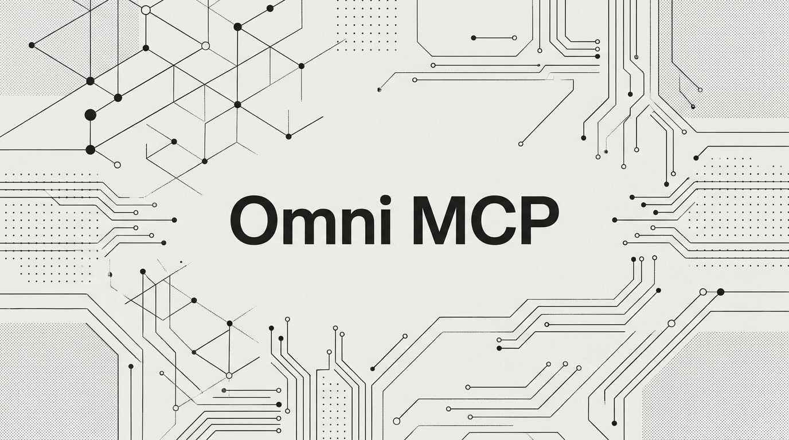

# Omni MCP v4.7.1 — "Trust Boundary Reset & Security Hardening"

<p align="center">
  
</p>

Omni MCP v4.7.1 is a critical security hardening and trust-boundary reset release addressing findings identified in the v5.0 roadmap security audit. It enforces universal route-level authorization across all endpoints, eliminates continuation replay race conditions through atomic Compare-and-Swap (CAS), hardens HTTP socket framing and worker-pool resilience, eliminates stack-overflow DoS vectors, and adds POSIX `fsync` durability guarantees — all while preserving our pure Rust standard-library runtime with **zero runtime dependencies** and `#![forbid(unsafe_code)]`.

---

### 🌟 Key Security Fixes & Improvements

#### 1. 🛡️ Universal Route Authorization & 4-Tier RBAC
- **Deny-by-Default Authorization Middleware**: Every HTTP `/api/*` endpoint now mandates Bearer token authentication and enforces strict Role-Based Access Control (RBAC):
  - **`Agent` role**: `/api/execute`, `/api/stats`, `/api/servers`, `/api/codemode/eval`, `/api/codemode/types`, `/api/codemode/speculative_types`, `/api/codemode/simulate`
  - **`Operator` role**: `/api/traces`, `/api/audit`, `/api/audit/verify`, `/api/diffs`, `/api/tools/propose_update`
  - **`Approver` role**: `/api/codemode/suspended`, `/api/codemode/resume`, `/api/diffs/approve`
  - **`Admin` role**: `/api/tools/toggle_status`, `/api/servers/toggle_status`, `/api/tools/rollback`, `/api/crawler/trigger`
- **Constant-Time Verification**: API keys and tokens are validated using constant-time byte comparisons (`constant_time_eq`) against `OMNI_AUTH_SECRET`.
- **Fail-Fast Bind Validation**: The gateway defaults to `127.0.0.1` and strictly refuses to bind to non-loopback network addresses if `OMNI_AUTH_SECRET` is unset.
- **Sensitive Field Redaction**: `GET /api/codemode/suspended` strictly redacts internal AST state, including `script_source`, `serialized_scope`, `pending_arguments`, and `frame_hmac`.

#### 2. 🔐 Atomic CAS Resumption & Continuation Hardening
- **Atomic Compare-and-Swap (`consume_frame`)**: Resolves race conditions in human-in-the-loop approvals by checking `!frame.is_consumed`, marking it consumed, appending to WAL, and calling `sync_all()` under a write lock *prior* to executing the downstream mutation. Racing concurrent resumes are rejected with `-32038 APPROVAL_INVALID`.
- **Cryptographic Separation of Duties**: Requesters are cryptographically prevented from approving their own mutations (`approver == caller_actor` is rejected).
- **Approver Argument Digest Verification**: Approvers can supply an expected SHA-256 argument digest upon resumption, verified case-insensitively before execution.
- **Dynamic Continuation HMAC**: Continuation frames are canonically signed with length-prefixed encoding across all 12 frame fields using keys derived from `OMNI_AUTH_SECRET` or per-process random keys (removing static public keys).

#### 3. 🌐 Strict HTTP Request Framing & DoS Containment
- **Persistent Connection Framing**: Preserves a single `BufReader` across HTTP/1.1 keep-alive loops, preventing dropped pipelined requests.
- **Strict RFC 9110 Protocol Validation**:
  - Rejects non-digit `Content-Length` headers with `400 Bad Request`.
  - Rejects `Transfer-Encoding: chunked` without `Content-Length` with `501 Not Implemented`.
  - Rejects conflicting framing headers with `400 Bad Request`.
  - Immediately terminates connections when `Content-Length` exceeds the configured payload limit (`413 Payload Too Large`).
  - Caps request lines and individual header lines at 8,192 bytes.
- **JSON Recursion Depth Limit**: `MAX_JSON_DEPTH = 64` enforced in the recursive-descent JSON parser, preventing worker thread stack overflow crashes.
- **Worker-Pool Resilience**: Bounded worker channel shedding saturated requests with `503 Service Unavailable`, and connection-level `std::panic::catch_unwind` preventing thread death.

#### 4. 💾 Storage Durability & Fsync Guarantees
- **WAL & Snapshot Fsync**: Added `f.sync_all()` after every WAL append, temporary snapshot commit before atomic rename, snapshot truncation, and Merkle audit log append.

#### 5. 🤝 Protocol Negotiation Honesty
- **Capability Matrix Honesty**: Flagged `2026-07-28` as `implemented: false` in `PROTOCOL_CAPABILITY_TABLE` and updated negotiation fallback to `2025-11-25`, ensuring the gateway only advertises fully implemented protocol revisions.

#### 6. 📦 Supply Chain & Tooling
- **Verified Package Downloads**: Updated `bin/omni-mcp.js` to download precompiled binaries to a temporary file, compute SHA-256, and verify against `SHA256SUMS` before caching.
- **CLI Subcommand Support**: Added native `--version`, `-V`, `version`, `aifx ...`, and `mcp ...` subcommand execution to the binary entrypoints.
- **Container Hardening**: Dockerfile updated with non-root user (`USER omni:omni`) and a `/healthz` container `HEALTHCHECK`.

---

### 📐 Authoritative `-320xx` Error-Code Contract

| Code | Constant | Description |
| :--- | :--- | :--- |
| `-32030` | `CIRCUIT_OPEN` | Downstream service circuit breaker is open. |
| `-32031` | `APPROVAL_REQUIRED` | Script paused at human approval gate; resume via `execution_id`. |
| `-32032` | `FUEL_EXHAUSTED` | Code Mode script exceeded instruction fuel budget. |
| `-32033` | `OUTBOUND_BLOCKED` | Raw network/filesystem access denied by `globalOutbound: null`. |
| `-32034` | `SAGA_COMPENSATED` | Multi-step mutations rolled back in reverse LIFO order. |
| `-32035` | `SCHEMA_PREFLIGHT_FAILED` | Tool arguments failed schema preflight validation. |
| `-32036` | `MEMORY_EXHAUSTED` | Code Mode script exceeded memory allocation budget. |
| `-32037` | `TIMEOUT` | Code Mode script exceeded wall-clock execution time limit. |
| `-32038` | `APPROVAL_INVALID` | Continuation token verification failed, expired, replayed, or altered. |

---

### 📦 Installation Across All Operating Systems

#### 1. Universal Zero-Install via NPX / GitHub Packages (macOS, Linux, Windows)

```bash
# Run stdio MCP server directly via NPX
npx -y @rangow4562/omni-mcp --stdio

# Run AIFx CLI extension
npx -y @rangow4562/omni-mcp aifx mcp --help
```

#### 2. Pre-Built Native Binaries Matrix

| Operating System | Architecture | Target Triple | Asset Name |
| :--- | :--- | :--- | :--- |
| **macOS** | Apple Silicon (M1/M2/M3/M4) | `aarch64-apple-darwin` | `omni-gateway-darwin-arm64` |
| **macOS** | Intel (x86_64) | `x86_64-apple-darwin` | `omni-gateway-darwin-x64` |
| **Linux** | x86_64 (glibc) | `x86_64-unknown-linux-gnu` | `omni-gateway-linux-x64` |
| **Linux** | ARM64 / AArch64 | `aarch64-unknown-linux-gnu` | `omni-gateway-linux-arm64` |
| **Windows** | x64 (Intel / AMD) | `x86_64-pc-windows-msvc` | `omni-gateway-win32-x64.exe` |
| **Windows** | ARM64 (Snapdragon / Surface) | `aarch64-pc-windows-msvc` | `omni-gateway-win32-arm64.exe` |

#### 🍎 macOS (Apple Silicon & Intel)
```bash
curl -fL https://github.com/Rangow4562/omni-mcp-gateway/releases/download/v4.7.1/omni-gateway-darwin-arm64 -o omni-gateway
chmod +x omni-gateway && ./omni-gateway --stdio
```

#### 🐧 Linux (x64 & ARM64)
```bash
curl -fL https://github.com/Rangow4562/omni-mcp-gateway/releases/download/v4.7.1/omni-gateway-linux-x64 -o omni-gateway
chmod +x omni-gateway && ./omni-gateway --stdio
```

#### 🪟 Windows (PowerShell — x64 & ARM64)
```powershell
Invoke-WebRequest -Uri "https://github.com/Rangow4562/omni-mcp-gateway/releases/download/v4.7.1/omni-gateway-win32-x64.exe" -OutFile "omni-gateway.exe"
.\omni-gateway.exe --stdio
```

#### 3. Integrity Verification (SHA256SUMS)
```bash
curl -fL https://github.com/Rangow4562/omni-mcp-gateway/releases/download/v4.7.1/SHA256SUMS -o SHA256SUMS
sha256sum --check SHA256SUMS --ignore-missing
```

#### 4. Build and Verify From Source
```bash
cargo fmt --all -- --check
cargo clippy --all-targets -- -D warnings
cargo test --locked
```

---

**Full Changelog**: https://github.com/Rangow4562/omni-mcp-gateway/compare/v4.7.0...v4.7.1

