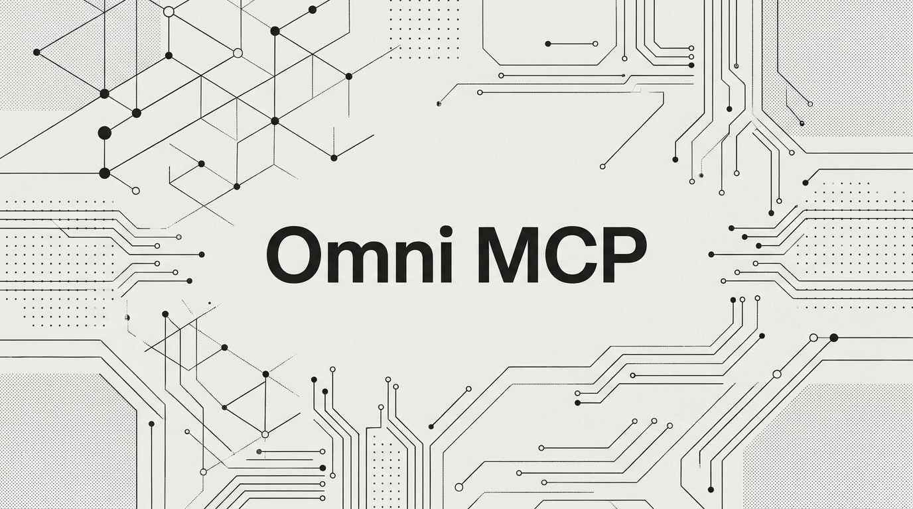
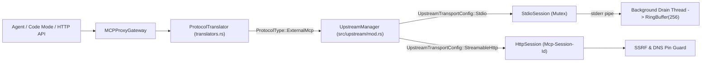
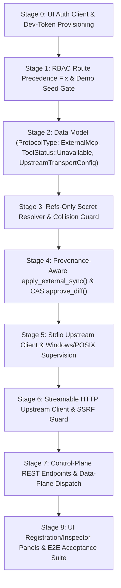

# Omni MCP v5.5.0 Roadmap & Implementation Plan — "Unified External MCP Fleet"

<p align="center">
  
</p>

* **Target Version:** `v5.5.0`
* **Baseline Commit:** `83b75ab7` (`v5.0.0`)
* **Source Brief:** [`concepts_brief.md`](../concepts_brief.md) (EGM 6-Lens Goldfish Review)
* **Runtime Constraints:** Pure Rust 2021 Standard Library (`std`-only, zero runtime dependencies, `#![forbid(unsafe_code)]`)

---

## 1. Executive Summary & Vision

Omni MCP v5.5.0 ports MCPJungle's **register-and-manage-MCP-servers** workflow into `omni-mcp` so that external Model Context Protocol servers (**`stdio`** subprocesses and **`Streamable HTTP`** endpoints) can be registered in one place and their tools become **first-class `ToolRecord`s** inside the existing `MCPRegistry`.

Because Okapi BM25 search, Code Mode JS/TS execution, `.d.ts` TypeScript declaration generation, RBAC, PII redaction, semantic caching, and the SHA-256 Merkle audit trail all derive from `ServerRecord` and `ToolRecord` at query time, external MCP tools inherit every enterprise gateway capability with zero parallel bookkeeping.

### Core Pillars of v5.5.0

1. **One Unified Registry (`ProtocolType::ExternalMcp`)**: External servers extend `ServerRecord` with a tagged `UpstreamTransportConfig` enum; live process/session state stays isolated in an in-memory `UpstreamManager` outside the WAL.
2. **Refs-Only Secret Hygiene**: Credentials (`{env:NAME}` and `{file:PATH}`) are validated at registration and resolved exclusively at spawn/connect time—never persisted to WAL, snapshots, diffs, logs, audit entries, or UI payloads.
3. **Provenance-Aware Schema Sync**: Operator-triggered rediscovery reconciles upstream tool catalogs via `apply_external_sync()`, emitting auto-approved `ConfigDiff` rows tagged `origin: external_sync` while protecting human-overridden fields (`SchemaSource::Human`) and guarding `approve_diff` with Compare-And-Swap (CAS) version checks.
4. **Hardened Process & Network Boundaries**: Config-owned `OMNI_MCP_STDIO_ALLOWLIST` with canonicalized binary verification, scrubbed child environments, dedicated `stderr` ring-buffer drain threads, and an upstream SSRF / DNS-rebinding guard.
5. **Authenticated Same-Origin UI & MCPJungle Control Surface**: Fixes existing UI unauthenticated fetch breakage first (Prerequisite 0), then delivers the External MCP Registration, Rediscovery, and Live Inspector panels.

---

## 2. Resolution of the Three Blocking Architecture Decisions

| # | Blocker Identified in Review | v5.5.0 Architectural Decision | Rationale & Upgrade Path |
| :--- | :--- | :--- | :--- |
| **D1** | **TLS Absence vs. HTTPS SaaS Fleet**: Zero-dep Rust `std` has no TLS stack, while 4 of 17 reference servers use `https://` and 13 of 17 use `stdio`. | **Ship full `stdio` (covering 13/17 fleet servers) + `http://` Streamable HTTP in v5.5.0** with strict `http://` validation and actionable error code `-32014 UPSTREAM_TLS_UNSUPPORTED` directing `https://` SaaS upstreams to register via a local stdio bridge (`npx -y supergateway` / `mcp-proxy`) or local TLS-terminating reverse proxy. | Preserves the zero-dependency `#![forbid(unsafe_code)]` guarantee without hand-rolling crypto. Evaluates optional feature-gated `rustls`/`rmcp` in v5.6 if native HTTPS egress is required. |
| **D2** | **Route RBAC Prefix Bug & Stdio RCE Risk**: `src/server.rs:499` matches `path.starts_with("/api/servers/") => AuthRole::Agent` *before* `/api/servers/toggle_status => AuthRole::Admin` (line 510), making the Admin guard unreachable and exposing any new `/api/servers/*` registration routes to `Agent` tokens. | **Reorder RBAC match arms so all specific mutation routes match `AuthRole::Admin` before the read-only prefix arm**, and enforce a config-file/env-owned **`OMNI_MCP_STDIO_ALLOWLIST`** (canonicalized absolute binary paths, never API-editable, verified at both registration and spawn). | Eliminates privilege escalation and prevents an `Agent` or compromised API call from registering arbitrary shell commands. |
| **D3** | **Auto Schema Sync Corrupts Rollback & Clobbers Human Edits**: `register_server` overwrites `description`/`input_schema` without recording durable before/after diffs, and `approve_diff` lacks a version check. | **Implement `MCPRegistry::apply_external_sync()`** writing auto-approved `ConfigDiff` rows (`origin: ChangeOrigin::ExternalSync`, `before_state` + `after_state` populated), track per-tool `schema_source: SchemaSource::{Upstream, Human}`, and enforce a **CAS version guard (`409 Conflict`) in `approve_diff`**. | Reuses the existing WAL-persisted diff ledger and `rollback_tool` machinery for free; human edits are never silently overwritten by upstream rediscovery. |
| **D4** | **Windows Child Process Supervision & Containment**: `Command::new("npx")` fails on Windows without `.cmd`/`.exe` resolution, undrained `stderr` deadlocks at 64 KB, and crashes can orphan grandchildren without `windows-sys` Job Objects. | **Resolve and canonicalize executable paths at registration; spawn one `stderr` drain thread per child into a bounded ring buffer; lazy-restart on call; kill children on graceful shutdown (`Drop` + shutdown hook).** | Documented orphan-on-hard-crash (`SIGKILL` / power loss) keeps `#![forbid(unsafe_code)]` intact while solving the 64 KB pipe deadlock and `CreateProcess` path resolution cleanly. |
| **D5** | **RBAC UI Acceptance Scope**: UI has no automated browser test runner today. | **Prerequisite 0 fixes `ui/src/api.ts` + Dev Token banner; v5.5.0 includes backend integration tests for all RBAC/registration/sync routes plus a deterministic E2E test harness against a real stdio/HTTP mock MCP server.** | Ensures every security and protocol invariant is verified in `cargo test` while providing a working interactive UI under Bearer auth. |

---

## 3. Security & Policy Matrix

### 3.1 Inbound RBAC Route Matrix (`src/server.rs`)

All `/api/*` and `/api/v1/*` routes are normalized before role evaluation. Specific mutation arms **must** precede prefix arms:

| Endpoint | HTTP Method | Required Role | Cache Refresh | Description |
| :--- | :---: | :---: | :---: | :--- |
| `/api/v1/servers/external/register` | `POST` | **`Admin`** | `refresh_now()` | Validate refs/allowlist/collisions, handshake `initialize` + `tools/list`, persist `ServerRecord` (`Disabled`). |
| `/api/v1/servers/external/:name/deregister` | `POST` / `DELETE` | **`Admin`** | `refresh_now()` | Stop stdio child / close HTTP session, remove server and tools from registry + WAL. |
| `/api/v1/servers/external/:name/rediscover` | `POST` | **`Admin`** | `refresh_now()` | Single-flight upstream fetch outside lock, reconcile via `apply_external_sync()`, return counts. |
| `/api/v1/servers/external/:name/inspect` | `GET` | **`Agent`** | — | Return live health, last `initialize` time, session mode, tool counts, and `stderr` ring-buffer tail (redacting any secrets). |
| `/api/servers/toggle_status` | `POST` | **`Admin`** | `refresh_now()` | Enable/disable server (fixed ordering bug at `src/server.rs:499`). |
| `/api/tools/toggle_status` | `POST` | **`Admin`** | `refresh_now()` | Enable/disable individual tool (`Disabled` ↔ `Enabled`). |
| `/api/tools/rollback` | `POST` | **`Admin`** | `refresh_now()` | Roll back tool to previous version using `version_history` or `ConfigDiff.before_state`. |
| `/api/crawler/trigger` | `POST` | **`Admin`** | `refresh_now()` | Trigger AutoCrawler sweep. |
| `/api/tools/propose_update` | `POST` | **`Operator`** | — | Propose human schema/description override (sets `schema_source: Human` upon approval). |
| `/api/diffs/approve` | `POST` | **`Approver`** | `refresh_now()` | Approve pending diff with CAS check (`tool.version == diff.previous_version`, else `409`). |
| `/api/servers`, `/api/servers/:name` | `GET` | **`Agent`** | — | List servers or fetch server detail (`encodeURIComponent` safe). |

### 3.2 Outbound Network & Process Boundary Matrix

| Mode (`OMNI_ENV`) | Inbound Auth (`OMNI_AUTH_SECRET`) | Outbound `StreamableHttp` Egress Policy | Outbound `Stdio` Process Policy |
| :--- | :--- | :--- | :--- |
| **`development`** (Loopback `127.0.0.1`) | Provisioned Dev Token or Static Secret | Allows loopback (`127.0.0.1`, `localhost`, `::1`) and LAN; **blocks cloud metadata IPs** (`169.254.169.254`, `100.100.100.200`, `fe80::/10`), pins DNS pre-connect, refuses `3xx` redirects. | Requires executable to match `OMNI_MCP_STDIO_ALLOWLIST` (canonicalized absolute path); scrubbed child env (`env_clear()`). |
| **`production`** (Network or Loopback) | Mandatory `OMNI_AUTH_SECRET` (fail-fast startup if unset on non-loopback) | Blocks cloud metadata IPs, link-local, and unspecified (`0.0.0.0`); loopback allowed **only** if `OMNI_MCP_ALLOW_LOOPBACK_UPSTREAM=true`; pins resolved IP pre-connect; refuses `3xx` redirects. | Requires `OMNI_MCP_STDIO_ALLOWLIST` (empty allowlist in production denies all stdio registrations with `403`). |

---

## 4. Detailed Component Specifications

### 4.1 Data Model Extensions (`src/models/entities.rs`)

1. **`ProtocolType` Expansion (Line 219)**:
   ```rust
   #[derive(Clone, Copy, Debug, PartialEq, Eq)]
   pub enum ProtocolType {
       Http,
       Grpc,
       TChannel,
       NativeMcp,
       ThirdParty,
       ExternalMcp,
   }
   ```
   - `as_str()` → `"External_MCP"`.
   - `from_str()` → `"External_MCP" | "external_mcp" | "EXTERNAL_MCP" => ProtocolType::ExternalMcp`.
   - **Downgrade Rule**: Documented in release notes and enforced via round-trip WAL serialization tests.

2. **`ToolStatus` & Retirement Tracking (Line 251)**:
   ```rust
   #[derive(Clone, Copy, Debug, PartialEq, Eq)]
   pub enum ToolStatus {
       Disabled,
       PendingReview,
       Enabled,
       Unavailable,
   }
   ```
   - Add `pub schema_source: SchemaSource` (`Upstream | Human`, default `Upstream`), `pub retired_at: Option<f64>`, and `pub last_seen_in_sync: Option<f64>` to `ToolRecord`.
   - **Revival Policy**: When an `Unavailable` tool reappears in an upstream sync:
     - If `sha256(new_input_schema) == sha256(old_input_schema)` and `new_description == old_description`, restore its pre-retirement status (`Disabled` or `Enabled`, stored in `metadata["prior_status"]`).
     - If its schema or description changed, transition to `ToolStatus::PendingReview` so an operator reviews the changed contract before exposure.

3. **Tagged Transport Configuration (`UpstreamTransportConfig`)**:
   ```rust
   #[derive(Clone, Copy, Debug, PartialEq, Eq)]
   pub enum SessionMode {
       Stateless,
       Stateful,
   }

   #[derive(Clone, Debug, PartialEq)]
   pub enum UpstreamTransportConfig {
       Stdio {
           command: String,
           canonical_command: String,
           args: Vec<String>,
           env_refs: BTreeMap<String, String>,
           cwd: Option<String>,
       },
       StreamableHttp {
           url: String,
           bearer_ref: Option<String>,
           header_refs: BTreeMap<String, String>,
           session_mode: SessionMode,
       },
   }
   ```
   - Stored on `ServerRecord` as `pub upstream_config: Option<UpstreamTransportConfig>`.
   - Serialized to/from JSON in `ServerRecord::to_json()` / `from_json()` containing **only reference strings** (`{env:...}`, `{file:...}`), never resolved secret bytes.

4. **Diff Provenance (`ChangeOrigin`)**:
   ```rust
   #[derive(Clone, Copy, Debug, PartialEq, Eq)]
   pub enum ChangeOrigin {
       Human,
       ExternalSync,
       AutoCrawler,
   }
   ```
   - Added to `ConfigDiff` (`pub origin: ChangeOrigin`, defaulting to `ChangeOrigin::Human` when loading legacy WAL entries).

---

### 4.2 Refs-Only Credential Resolver (`src/upstream/secrets.rs`)

- **Allowed Syntax**:
  - `{env:VAR_NAME}` where `VAR_NAME` matches `^[A-Z_][A-Z0-9_]*$` and is **not** `OMNI_AUTH_SECRET`.
  - `{file:relative/or/abs/path}` which is canonicalized via `std::fs::canonicalize` and verified to reside inside `config.secrets_dir` (`OMNI_MCP_SECRETS_DIR`).
- **Strict Rejection of Raw Secrets**:
  - During `register` Validation: Any value in `bearer_ref`, `header_refs`, or `env_refs` that does not match `^\{(env|file):[^}]+\}$` is rejected with `400 Bad Request` (`"Raw credentials are not permitted; use {env:NAME} or {file:PATH}"`).
- **Zero-Persistence Guarantee**:
  - `resolve_secret_ref(&str, &Config) -> Result<String, String>` is invoked only inside `StdioUpstreamSession::spawn()` and `HttpUpstreamSession::send_rpc()`.

---

### 4.3 Namespace & Sanitized-Identifier Collision Guard (`src/control_plane/registry.rs`)

- **Server Naming**: External servers are keyed as `external-mcp:<slug>` (or user-provided slug normalized to lowercase ASCII alphanumeric + `-`/`_`), with display metadata preserved.
- **Three-Level Collision Check** (enforced at both `register_external_server` and `apply_external_sync`):
  1. **Server-level**: `sanitize_ident(&new_server_name)` must not collide with `sanitize_ident(&existing_server_name)` across any existing server in `MCPRegistry` (including built-in/crawler servers).
  2. **Tool-level**: Within a server, no two tools may produce the same `sanitize_ident(&tool.name)` (e.g., `web-search` and `web_search` both map to `web_search`).
  3. **Property-level**: Top-level `input_schema.properties` keys for a tool must not collide under `sanitize_ident`.
- **Error Contract**: Collisions return `409 Conflict` with JSON body `{ "error": "IDENTIFIER_COLLISION", "sanitized": "...", "first_raw": "...", "second_raw": "..." }`.

---

### 4.4 Provenance-Aware Reconciliation (`MCPRegistry::apply_external_sync`)

When `POST /api/v1/servers/external/:name/rediscover` runs:

1. **Single-Flight Guard**: `UpstreamManager` acquires a per-server rediscovery lock (or returns `409 Conflict: Rediscovery already in progress for server`).
2. **Lock-Free Upstream Fetch**: Connects to the upstream server, runs `initialize` + `notifications/initialized` + paginated `tools/list` **outside** the `MCPRegistry` write lock.
3. **Identifier Validation**: Verifies no tool-level or property-level `sanitize_ident` collisions exist in the fetched catalog.
4. **Atomic Reconciliation Inside Write Lock (`apply_external_sync`)**:
   - **Added Tools**: Inserted with `status: ToolStatus::Disabled`, `version: 1`, `protocol: ProtocolType::ExternalMcp`, `schema_source: SchemaSource::Upstream`, `last_seen_in_sync: Some(now)`. Emits an auto-approved `ConfigDiff` (`origin: ExternalSync`, `before_state: Null`, `after_state: tool.to_json()`).
   - **Existing Active Tools**:
     - Preserves `status` (`Enabled` stays `Enabled`, `Disabled` stays `Disabled`), `charter_policy`, `is_mutation`, and `compensation_spec` via a shared `preserve_tool_governance_fields()` helper.
     - If `description` and `input_schema` are identical to stored state: increments `unchanged_count`, updates `last_seen_in_sync`.
     - If changed and `tool.schema_source == SchemaSource::Upstream`: updates `description`/`input_schema`, increments `tool.version`, appends snapshot to `version_history`, and writes an **auto-approved `ConfigDiff`** (`origin: ExternalSync`, `before_state`, `after_state`) so `rollback_tool` can revert to the prior upstream version.
     - If changed and `tool.schema_source == SchemaSource::Human`: **does not overwrite** the human-edited tool; instead creates an **unapproved `ConfigDiff`** (`origin: ExternalSync`, `approved: false`) in the diff review queue so an Approver can resolve the divergence.
   - **Missing (Retired) Tools**:
     - Any tool previously present on the server that is absent from the upstream `tools/list` transitions to `ToolStatus::Unavailable`, records `retired_at = Some(now)`, stores `metadata["prior_status"]`, increments `tool.version`, and writes an auto-approved `ConfigDiff` (`origin: ExternalSync`).
   - **Reappearing (Revived) Tools**:
     - Follows the Revival Policy (§4.1.2).
5. **Durable Flush & Cache Refresh**:
   - Saves updated `ServerRecord` and `ConfigDiff` rows to `WalRegistryStore` (with `sync_all()`), then calls `gateway.cache.refresh_now()`.
6. **Reconciliation Summary Return**:
   - Returns `{ "added": N, "updated": N, "retired": N, "unchanged": N, "pending_human_conflicts": N }`.

---

### 4.5 Upstream Transport Engine (`src/upstream/`)



#### 1. `src/upstream/stdio.rs` (`StdioUpstreamSession`)
- **Allowlist & Path Resolution**:
  - Reads `OMNI_MCP_STDIO_ALLOWLIST` (semicolon-separated on Windows, colon/semicolon-separated on Unix).
  - Canonicalizes allowlist entries and candidate `command` via `std::fs::canonicalize`. On Windows, if `command` has no extension, probes `.exe` and `.cmd` before canonicalizing; rejects `cmd.exe /C` wrapper injection.
- **Process Isolation**:
  - Spawns with `Command::new(&canonical_cmd).args(&args).env_clear().stdin(Stdio::piped()).stdout(Stdio::piped()).stderr(Stdio::piped())`.
  - Populates only resolved `env_refs` plus safe OS loader variables (`SystemRoot` on Windows, `PATH` if configured). `OMNI_AUTH_SECRET` is never passed.
- **Deadlock-Free `stderr` Drain**:
  - Spawns a detached reader thread per child that reads lines from `ChildStderr` into `Arc<Mutex<VecDeque<String>>>` capped at 256 lines (4 KB per line max).
- **MCP Handshake & Framing**:
  - Sends `initialize` JSON-RPC request (`protocolVersion: "2025-11-25"`) followed by `notifications/initialized`.
  - Reads newline-delimited JSON-RPC responses (`\r\n` and `\n` tolerant), skipping server notifications or rejecting unsupported server-to-client requests (`sampling/createMessage`, `elicitation/create`) with JSON-RPC `-32601 Method not found` so the child never blocks waiting for a response.
- **Concurrency & Lazy Restart**:
  - Protected by a per-server `Mutex<StdioState>`.
  - If the child has exited (`try_wait()` returns `Ok(Some(_))`), marks health `Unreachable` and lazily respawns on the next `call_tool` or `rediscover`.
  - `UpstreamManager::shutdown_all()` iterates all active children, sends `Child::kill()`, and `Child::wait()`s to leave zero orphan processes on gateway exit.

#### 2. `src/upstream/http.rs` (`HttpUpstreamSession`)
- **SSRF & Scheme Guard**:
  - Rejects `https://` with `-32014 UPSTREAM_TLS_UNSUPPORTED` and a clear message explaining how to bridge HTTPS MCP servers via stdio (`npx -y supergateway --sse/--streamableHttp ...`) or a local TLS proxy.
  - Resolves hostname via `ToSocketAddrs`, verifies every resolved IP against the SSRF deny-list (cloud metadata `169.254.169.254`, link-local `169.254.0.0/16`, `fe80::/10`, loopback in production unless `OMNI_MCP_ALLOW_LOOPBACK_UPSTREAM=true`), and connects directly to the pinned `SocketAddr`.
  - Never follows HTTP `3xx` redirects.
- **Session Lifecycle (`SessionMode::Stateful` vs `SessionMode::Stateless`)**:
  - Captures `Mcp-Session-Id` response header from `initialize` when `Stateful` (or when returned by upstream) and sends it on subsequent POSTs.
  - If a `tools/call` or `tools/list` receives HTTP `404 Not Found` in `Stateful` mode, automatically re-runs `initialize` once to obtain a fresh `Mcp-Session-Id` and retries the request.
- **Pagination**:
  - Follows `nextCursor` in `tools/list` responses up to `MAX_PAGINATION_PAGES = 50` (preventing infinite cursor loops).

#### 3. Data-Plane Result Mapping (`src/data_plane/translators.rs`)
- Adds the 6th exhaustive match arm `ProtocolType::ExternalMcp` in `ProtocolTranslator::execute_tool_call`.
- Extracts MCP `tools/call` result:
  1. If `result.get("isError") == Some(true)`, returns `Err(extracted_error_text)` so the gateway circuit breaker and Saga compensation unwind trigger properly.
  2. If `result.get("structuredContent")` is present and non-null, returns it directly as `JsonValue`.
  3. Otherwise inspects `result.get("content")` array: if a single `"type": "text"` block is valid JSON, parses and returns it; otherwise returns `json!({ "text": combined_text, "content": content_arr })`.

---

### 4.6 React Dashboard Overhaul (`ui/src/`)

1. **Prerequisite 0 — Authenticated API Client (`ui/src/api.ts`)**:
   - Replaces all hardcoded `http://localhost:8080/api/...` calls across `ui/src/App.tsx` and components with `apiFetch(path, options)`:
     - Uses relative paths (`/api/...`) so same-origin requests work on any port/host.
     - URL-encodes server and tool identifiers with `encodeURIComponent()`.
     - Attaches `Authorization: Bearer <token>` read from `localStorage.getItem('omni_mcp_token')` (defaulting in dev mode to `dev_admin_token` when `OMNI_AUTH_SECRET` is unset, with a one-click Role/Token selector in `Header.tsx` to test `Agent`, `Operator`, `Approver`, and `Admin` personas).
     - Surfaces structured error banners for `401 Unauthorized`, `403 Forbidden`, and `409 Conflict`.
2. **External MCP Server Registration Modal (`ui/src/components/RegisterExternalServerModal.tsx`)**:
   - Ported from MCPJungle's registration form, adapted for `omni-mcp` security:
     - Server Slug, Display Name, Description, Owning Team.
     - Transport selector: **`stdio` (Local Subprocess)** vs. **`Streamable HTTP` (Remote/LAN Endpoint)**.
     - For `stdio`: Command path, Arguments list, Working Directory, and Environment Variable Refs (`KEY` → `{env:VAR}` or `{file:PATH}`).
     - For `Streamable HTTP`: Endpoint URL (`http://...`), Session Mode (` stateful` / `stateless`), Bearer Token Ref (`{env:...}` / `{file:...}`), and Custom Header Refs.
     - Built-in client-side validator that highlights raw secrets and guides the operator to use `{env:NAME}` or `{file:PATH}`.
3. **External Server Inspector & Rediscovery View (`ui/src/components/ExternalServerInspector.tsx`)**:
   - Displays connection health (`Connected`, `Idle`, `Unreachable`), protocol badge (`EXTERNAL_MCP`), transport summary (with secret refs shown as symbolic badges, never resolved values), and last `initialize` timestamp.
   - **Rediscover Tools** button: triggers `POST /api/v1/servers/external/:name/rediscover` and renders a reconciliation toast/card (`+Added`, `~Updated`, `-Retired`, `=Unchanged`, `!Conflicts`).
   - **Stderr Diagnostics Drawer**: collapsible live viewer for the 256-line child `stderr` ring buffer (for `stdio` servers).
   - **Deregister Server** button with confirmation dialog.

---

## 5. Phased Implementation Plan (Stage 0 → Stage 8)



### Stage 0: UI Auth Client & Dev-Token Provisioning (Prerequisite Zero)
- **Files**: `ui/src/api.ts` (new), `ui/src/App.tsx`, `ui/src/components/Header.tsx`, `src/server.rs`.
- **Tasks**:
  - Create `ui/src/api.ts` with `apiFetch()`, relative URL resolution, `encodeURIComponent()` helpers, and `localStorage` Bearer token management.
  - Add a Dev Token / Role Switcher control in `Header.tsx` (`admin_dev_token`, `approver_dev_token`, `operator_dev_token`, `agent_dev_token`, or custom Bearer input).
  - Replace all 15+ hardcoded `http://localhost:8080` `fetch` calls in `App.tsx`.
- **Verification**: UI loads `/api/stats`, `/api/servers`, and `/api/diffs` with `200 OK` against a running gateway in both dev and `OMNI_AUTH_SECRET` modes.

### Stage 1: RBAC Route Precedence Fix & Demo Seed Gate
- **Files**: `src/server.rs`, `src/config.rs`, `src/main.rs`.
- **Tasks**:
  - In `src/server.rs:494-514`, move `/api/servers/toggle_status` and all `/api/v1/servers/external/*` mutation routes **above** `_ if path.starts_with("/api/servers/") => AuthRole::Agent`.
  - Gate the built-in demo catalog seed (`driverdispatchservice`, `paymentsservice`, `3p_jira`) behind `OMNI_MCP_DEMO_SEED=1` or `--demo` CLI flag at the whole-block level so restarts never re-seed or flip statuses on a production data directory.
  - Add configuration keys to `Config` (`src/config.rs`):
    - `OMNI_MCP_STDIO_ALLOWLIST` (`Vec<String>`)
    - `OMNI_MCP_SECRETS_DIR` (`PathBuf`, default `./secrets`)
    - `OMNI_MCP_UPSTREAM_CALL_TIMEOUT` (`u64`, default `120_000` ms)
    - `OMNI_MCP_ALLOW_LOOPBACK_UPSTREAM` (`bool`, default `true` in dev, `false` in prod)
    - `OMNI_MCP_DEMO_SEED` (`bool`, default `false`)
- **Verification**: Unit & integration test verifying an `Agent` token receives `403 Forbidden` on `POST /api/servers/toggle_status` and `POST /api/v1/servers/external/register`.

### Stage 2: Data Layer & WAL Backward Compatibility
- **Files**: `src/models/entities.rs`, `src/storage/wal_store.rs`.
- **Tasks**:
  - Add `ProtocolType::ExternalMcp`, `ToolStatus::Unavailable`, `SchemaSource::{Upstream, Human}`, `ChangeOrigin::{Human, ExternalSync, AutoCrawler}`, `SessionMode::{Stateless, Stateful}`, and `UpstreamTransportConfig`.
  - Extend `ToolRecord`, `ServerRecord`, and `ConfigDiff` JSON serialization/deserialization with backward-compatible defaults (`unwrap_or`).
- **Verification**: WAL round-trip unit tests (`test_wal_external_mcp_round_trip_and_legacy_snapshot_compat`) confirming old snapshots load cleanly and new `ExternalMcp` records survive restart with zero secret bytes persisted.

### Stage 3: Refs-Only Secret Resolver & Three-Level Collision Guard
- **Files**: `src/upstream/secrets.rs` (new), `src/control_plane/registry.rs`.
- **Tasks**:
  - Implement `validate_secret_ref_syntax()` and `resolve_secret_ref()` supporting `{env:NAME}` and `{file:PATH}` (with `canonicalize` prefix check against `OMNI_MCP_SECRETS_DIR`).
  - Implement `check_identifier_collisions()` across server names, tool names, and top-level schema properties using `sanitize_ident`.
- **Verification**: Unit tests for path-traversal rejection (`{file:../../etc/passwd}` → `Err`), raw token rejection (`Bearer sk-1234` → `Err`), and collision `409` responses naming both conflicting raw identifiers.

### Stage 4: Provenance-Aware `apply_external_sync` & CAS `approve_diff`
- **Files**: `src/control_plane/registry.rs`.
- **Tasks**:
  - Extract `preserve_tool_governance_fields()` helper shared by `register_server` and `apply_external_sync`.
  - Implement `MCPRegistry::apply_external_sync()` generating auto-approved `ConfigDiff` entries (`origin: ChangeOrigin::ExternalSync`, `before_state`, `after_state`) for `SchemaSource::Upstream` tools, unapproved `ConfigDiff`s for `SchemaSource::Human` conflicts, and `ToolStatus::Unavailable` transitions for retired tools (plus revival logic).
  - Add CAS version check in `MCPRegistry::approve_diff()`: if `tool.version != diff.previous_version`, return `Err("CONFLICT: Tool version has advanced since diff was proposed")`.
- **Verification**: Unit tests covering added/updated/retired/revived tool lifecycles, preservation of `Enabled` status across rediscover, human-override conflict surfacing, and `rollback_tool` restoring `before_state` from an `ExternalSync` diff.

### Stage 5: `stdio` Upstream Client & Windows/POSIX Process Supervision
- **Files**: `src/upstream/mod.rs` (new), `src/upstream/stdio.rs` (new).
- **Tasks**:
  - Implement executable path resolution (`.exe`/`.cmd` probe on Windows) and canonicalization against `OMNI_MCP_STDIO_ALLOWLIST`.
  - Implement `StdioUpstreamSession` with `env_clear()`, resolved `env_refs` injection, background `stderr` drain thread into a 256-line ring buffer, CRLF-tolerant JSON-RPC framing, `initialize` + `notifications/initialized` handshake, paginated `tools/list`, and timeout-bounded `tools/call` (`OMNI_MCP_UPSTREAM_CALL_TIMEOUT`).
  - Implement `UpstreamManager::shutdown_all()` and `Drop` cleanup so child processes are terminated on deregister or server shutdown.
- **Verification**: Integration test spawning a real child process, flooding `stderr` with >128 KB of output to prove zero deadlock, echoing a cryptographic nonce via `tools/call`, and verifying the child PID is terminated on gateway shutdown.

### Stage 6: `Streamable HTTP` Upstream Client & SSRF Guard
- **Files**: `src/upstream/http.rs` (new), `src/data_plane/downstream_http.rs`.
- **Tasks**:
  - Implement `validate_upstream_url_and_resolve()` enforcing `http://` scheme (returning `-32014 UPSTREAM_TLS_UNSUPPORTED` on `https://` with proxy guidance), blocking metadata/link-local IPs, and pinning the resolved `SocketAddr`.
  - Implement `HttpUpstreamSession` supporting `SessionMode::{Stateless, Stateful}`, `Mcp-Session-Id` header round-tripping, automatic re-initialization on `404`, cursor pagination on `tools/list`, and `-32601` rejection of server-initiated sampling/elicitation requests.
- **Verification**: Integration test against a local raw-socket HTTP MCP mock server testing `Mcp-Session-Id` lifecycle, `404` session-expiry recovery, paginated `tools/list`, SSRF metadata IP rejection (`http://169.254.169.254/mcp` → blocked), and `https://` actionable error contract.

### Stage 7: Control-Plane REST Endpoints & Data-Plane Dispatch Integration
- **Files**: `src/server.rs`, `src/data_plane/translators.rs`, `src/data_plane/gateway.rs`.
- **Tasks**:
  - Add exhaustive `ProtocolType::ExternalMcp` arm in `ProtocolTranslator::execute_tool_call` (`src/data_plane/translators.rs:42`) with the `structuredContent` / text JSON result-mapping rule.
  - Wire `POST /api/v1/servers/external/register`, `POST /api/v1/servers/external/:name/deregister` (and `DELETE`), `POST /api/v1/servers/external/:name/rediscover`, and `GET /api/v1/servers/external/:name/inspect` in `src/server.rs`.
  - Ensure every mutation route triggers `self.gateway.cache.refresh_now()`.
- **Verification**: End-to-end integration test registering both a `stdio` server and a `Streamable HTTP` server, enabling their tools, verifying immediate visibility in Okapi BM25 (`discover_tools`), `.d.ts` generation (`get_codemode_types`), and executing multi-tool scripts inside the Code Mode JS/TS sandbox.

### Stage 8: React UI Panels & Complete v5.5.0 Acceptance Suite
- **Files**: `ui/src/components/RegisterExternalServerModal.tsx` (new), `ui/src/components/ExternalServerInspector.tsx` (new), `ui/src/components/RegistryCatalog.tsx`, `ui/src/types.ts`, `tests/integration_tests.rs`.
- **Tasks**:
  - Build the MCPJungle-inspired Registration Modal (with `{env:...}` / `{file:...}` validation) and External Server Inspector panel (health, reconciliation counts, `stderr` tail, rediscover/deregister actions).
  - Run `npm run build` in `ui/` (if Node/Vite is used) and verify static asset serving.
  - Complete the 10-point v5.5.0 Acceptance Test Suite in `tests/integration_tests.rs`.

---

## 6. v5.5.0 Acceptance Criteria Checklist (Definition of Done)

1. **[AC-1] End-to-End `stdio` Registration & Nonce Echo**: Register a real local `stdio` MCP server process, enable the server and tool, invoke it via `/omni/mcp` (`tools/call`) and Code Mode (`execute_codemode`), and verify the echoed cryptographic nonce from the child process.
2. **[AC-2] End-to-End `Streamable HTTP` Registration & Session Lifecycle**: Register a local `http://` MCP server in `stateful` mode, verify `Mcp-Session-Id` propagation, simulate session expiry (`404`) and confirm transparent re-initialization, and verify nonce echo.
3. **[AC-3] First-Class Surface Inheritance**: Confirm that while `Disabled`, external tools do **not** appear in BM25 search or `.d.ts` declarations; immediately after an Admin enables the server and tool (`refresh_now()`), they appear in BM25 search, `.d.ts` type declarations, and Code Mode execution.
4. **[AC-4] Operator-Triggered Rediscovery & Provenance**: Trigger `/rediscover` after an upstream server adds a tool, updates a tool's schema, and retires a tool. Verify deterministic `{ added, updated, retired, unchanged }` counts, preservation of `Enabled` status on updated tools, auto-approved `ConfigDiff` rows with `origin: "external_sync"`, and successful `rollback_tool` execution.
5. **[AC-5] Human Override Protection & CAS Guard**: Edit an external tool's description via `propose_update` + `approve_diff` (`schema_source: Human`), trigger `/rediscover` with a conflicting upstream change, and verify the human description is preserved while a pending diff is queued. Verify stale `approve_diff` calls fail with `409 Conflict`.
6. **[AC-6] Zero Secret Bytes on Disk**: Register servers using `{env:NAME}` and `{file:PATH}` refs, trigger WAL compaction, and assert that raw secret strings do **not** appear anywhere in `registry.db`, `registry.db-wal`, `/api/servers`, `/api/diffs`, or `/api/audit`.
7. **[AC-7] Sanitized-Identifier Collision Rejection**: Attempt to register or sync colliding names (`pay-ments` vs `pay_ments`, or `web-search` vs `web_search` on the same server) and assert `409 Conflict` naming both raw inputs.
8. **[AC-8] RBAC & Allowlist Enforcement**: Verify `Agent`, `Operator`, and `Approver` tokens receive `403 Forbidden` on `/register`, `/deregister`, `/rediscover`, and `/api/servers/toggle_status`. Verify non-allowlisted `stdio` binaries and SSRF metadata IPs (`169.254.169.254`) are rejected.
9. **[AC-9] Windows/POSIX Supervision Resilience**: Flood child `stderr` with >128 KB of output and verify subsequent `tools/call` invocations complete without deadlocking; shut down the gateway and verify zero orphan child processes remain.
10. **[AC-10] Zero Warnings & Single-Sourced Drift Guard**: `cargo test --all-features`, `cargo clippy --all-targets --all-features -- -D warnings`, and `cargo fmt -- --check` pass with zero warnings.

